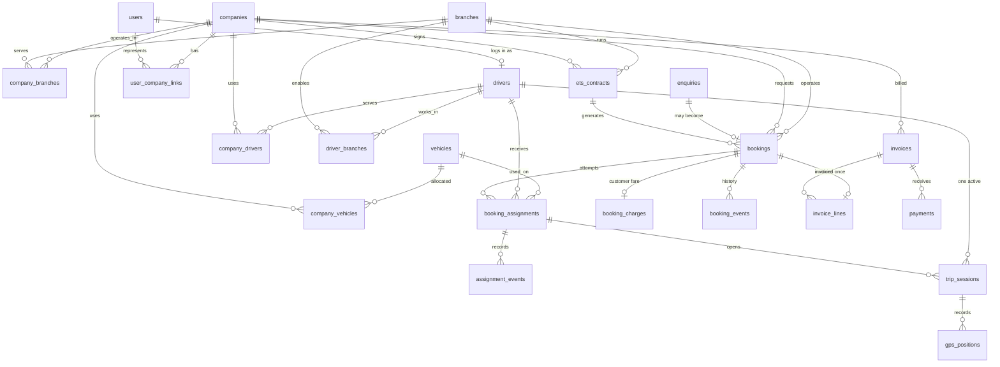

# PostgreSQL schema plan

Date: 18 November 2026. Revision 7, migration authority and trigger binding. This revision is not an approval. The SQL has not been executed.

Design only. PostgreSQL is not installed. No table is created. No application code, homepage, or production data is changed. No data is migrated.

Target: PostgreSQL 15 or newer, one database for the owner dashboard, the Flutter driver app, and a later client portal. Until a reviewed cutover, Flask keeps reading SQLite, `rac_data.json`, the OCR SQLite file, and Zoho Sheet.

## 1. What changed in this revision

Revision 2 remains the base. This revision corrects the SQL that was still unsafe or incomplete.

- Payment and invoice changes lock the invoice row, then compare exact `numeric(12,2)` INR amounts. Line deletes and payment moves cannot leave payments above the line total.
- GPS inserts and session closure lock the same session row. A second trip start locks the driver row. Unique indexes remain the backstop.
- Every protected table has explicit `SELECT`, `INSERT`, `UPDATE`, and `DELETE` policies, plus `GRANT` and `REVOKE` statements.
- Contract, booking, and invoice company-branch pairs use composite foreign keys. Assignment company checks use triggers because the company is stored on the booking.
- `booking_assignments` is the mutable current attempt. `assignment_events` is the immutable history. Status transitions are listed and checked. A deferred constraint checks that the booking, the open attempt, and the session agree at commit.
- Staging reloads are idempotent. A conflict row cannot be inserted as `clean`. Branch inference must be reviewed before cutover.
- Section 11 is the verification matrix. It is a test plan, not a test result.
- Revision 4 closes a finished booking's open assignment in the same transaction, replaces client access to `booking_assignments` with `client_duty_status`, and refuses fleet and message links that would no longer match.
- Revision 5 keeps that assignment change when the driver closes or cancels the session, and when staff complete or cancel the booking. A message that names a booking keeps that booking's company and branch, including when either value is null.
- Revision 6 does not use `app.lifecycle` or `app.close_reason`. `session_after` always applies the booking change. The cancel reason is taken from the session row.
- Revision 7 removes the migration test from inside the security-definer functions. Historical load is possible only while a superuser has turned ordinary triggers off. Each of those functions refuses to run unless it is attached to its own `public` table, and `EXECUTE` is revoked from `PUBLIC`.

## 2. Current sources

| Store | Records |
| --- | --- |
| `backend/database.db` | `inquiries`, `chat_logs`, `cabs`, `cab_documents`, `drivers`, `companies`, `company_cabs`, `trips`, `trip_passengers`, `safety_alerts` |
| `backend/rac_data.json` | `drivers`, `bookings`, `assignments`, `uploads`, `messages` |
| `tools/wa_booking_ingest/data/ingest.sqlite3` | `bookings`, `processed_messages`, `review_queue`, `jobs`, `stats`, `ingest_records` |
| Zoho Sheet | Mirror of the five RAC collections. Not the source of truth. |

Website drivers and RAC drivers stay separate people unless phone and licence both match. Driver names are not unique. `7822` and the duplicate Keerthi rows are not merged.

## 3. Entity relationship



Staging tables are a landing copy of every source row. They are listed in section 8. They are not part of daily dispatch.

## 4. Ownership

| Data | Who may read |
| --- | --- |
| All branches | Owner |
| One branch's duties, drivers, vehicles, messages | Staff with `user_branch_access` for that branch |
| Own assignments, own session, own GPS, own payout status | The driver logged in as that `drivers.user_id` |
| Own company's bookings, invoices, and balances | A client linked in `user_company_links` |
| Customer fare (`booking_charges`, `invoice_lines`, `payments`) | Owner, branch staff, and that company's client. Never a driver. |

The database decides the role from `users.role`. The application sets only `app.user_id` for the transaction. A client cannot claim the owner role by setting a session variable.

## 5. Live schema

Blank text is stored as null. Missing legacy ids and missing booking codes are null. They are never `''`.

```sql
CREATE FUNCTION null_if_blank(value text) RETURNS text
LANGUAGE sql IMMUTABLE AS $$
    SELECT NULLIF(btrim(value), '')
$$;

CREATE FUNCTION app_uid() RETURNS uuid
LANGUAGE sql STABLE AS $$
    SELECT NULLIF(current_setting('app.user_id', true), '')::uuid
$$;
```

### 5.1 Branches, people, and companies

```sql
CREATE TABLE branches (
    id uuid PRIMARY KEY DEFAULT gen_random_uuid(),
    code text NOT NULL UNIQUE,
    name text NOT NULL,
    city text NOT NULL,
    timezone text NOT NULL DEFAULT 'Asia/Kolkata',
    active boolean NOT NULL DEFAULT true
);

CREATE TABLE users (
    id uuid PRIMARY KEY DEFAULT gen_random_uuid(),
    role text NOT NULL CHECK (role IN ('owner', 'staff', 'driver', 'client')),
    full_name text NOT NULL,
    email text,
    phone text,
    password_hash text,
    google_sub text,
    status text NOT NULL DEFAULT 'active' CHECK (status IN ('active', 'disabled')),
    created_at timestamptz NOT NULL DEFAULT now(),
    CONSTRAINT users_email_not_blank CHECK (email IS NULL OR btrim(email) <> ''),
    CONSTRAINT users_phone_not_blank CHECK (phone IS NULL OR btrim(phone) <> ''),
    CONSTRAINT users_google_not_blank CHECK (google_sub IS NULL OR btrim(google_sub) <> '')
);

CREATE UNIQUE INDEX users_email_uq ON users (lower(email)) WHERE email IS NOT NULL;
CREATE UNIQUE INDEX users_google_uq ON users (google_sub) WHERE google_sub IS NOT NULL;

CREATE TABLE user_branch_access (
    user_id uuid NOT NULL REFERENCES users(id),
    branch_id uuid NOT NULL REFERENCES branches(id),
    PRIMARY KEY (user_id, branch_id)
);

CREATE TABLE companies (
    id uuid PRIMARY KEY DEFAULT gen_random_uuid(),
    name text NOT NULL,
    contact_person text,
    contact_email text,
    contact_phone text,
    address text,
    legacy_source text,
    legacy_id text,
    CONSTRAINT companies_legacy_pair CHECK (
        (legacy_source IS NULL AND legacy_id IS NULL)
        OR (legacy_source IS NOT NULL AND legacy_id IS NOT NULL)
    )
);

CREATE UNIQUE INDEX companies_legacy_uq
    ON companies (legacy_source, legacy_id)
    WHERE legacy_id IS NOT NULL;

CREATE TABLE company_branches (
    company_id uuid NOT NULL REFERENCES companies(id),
    branch_id uuid NOT NULL REFERENCES branches(id),
    PRIMARY KEY (company_id, branch_id)
);
CREATE INDEX company_branches_branch ON company_branches (branch_id);

CREATE TABLE user_company_links (
    user_id uuid NOT NULL REFERENCES users(id),
    company_id uuid NOT NULL REFERENCES companies(id),
    PRIMARY KEY (user_id, company_id)
);
CREATE INDEX user_company_links_company ON user_company_links (company_id);
```

Company name is not unique. "TCS" and "Tcs" both load. The dry run reports case and spacing matches for a person to merge. A unique name key would reject a legitimate second row.

### 5.2 Drivers and vehicles

```sql
CREATE TABLE drivers (
    id uuid PRIMARY KEY DEFAULT gen_random_uuid(),
    user_id uuid REFERENCES users(id),
    primary_branch_id uuid NOT NULL REFERENCES branches(id),
    display_name text NOT NULL,
    phone text,
    whatsapp_number text,
    alternate_number text,
    license_number text,
    license_expiry date,
    home_area text,
    active boolean NOT NULL DEFAULT true,
    notes text,
    legacy_source text,
    legacy_driver_id text,
    legacy_sqlite_id integer,
    branch_inferred boolean NOT NULL DEFAULT false
);

CREATE UNIQUE INDEX drivers_user_uq ON drivers (user_id) WHERE user_id IS NOT NULL;
CREATE UNIQUE INDEX drivers_legacy_uq
    ON drivers (legacy_source, legacy_driver_id)
    WHERE legacy_driver_id IS NOT NULL;
CREATE UNIQUE INDEX drivers_sqlite_uq
    ON drivers (legacy_sqlite_id)
    WHERE legacy_sqlite_id IS NOT NULL;
CREATE INDEX drivers_primary_branch ON drivers (primary_branch_id);

CREATE TABLE driver_branches (
    driver_id uuid NOT NULL REFERENCES drivers(id),
    branch_id uuid NOT NULL REFERENCES branches(id),
    PRIMARY KEY (driver_id, branch_id)
);
CREATE INDEX driver_branches_branch ON driver_branches (branch_id);

CREATE TABLE vehicles (
    id uuid PRIMARY KEY DEFAULT gen_random_uuid(),
    branch_id uuid NOT NULL REFERENCES branches(id),
    registration_number text,
    model text,
    capacity integer,
    fuel_type text,
    is_ev boolean NOT NULL DEFAULT false,
    status text NOT NULL DEFAULT 'active' CHECK (status IN ('active', 'inactive')),
    usual_driver_id uuid REFERENCES drivers(id),
    legacy_source text,
    legacy_id text,
    identity_status text NOT NULL DEFAULT 'clean'
        CHECK (identity_status IN ('clean', 'conflict')),
    branch_inferred boolean NOT NULL DEFAULT false,
    CONSTRAINT registration_not_blank CHECK (
        registration_number IS NULL OR btrim(registration_number) <> ''
    )
);

CREATE UNIQUE INDEX vehicles_registration_clean
    ON vehicles (registration_number)
    WHERE registration_number IS NOT NULL AND identity_status = 'clean';
CREATE INDEX vehicles_branch ON vehicles (branch_id);
CREATE INDEX vehicles_usual_driver ON vehicles (usual_driver_id);

CREATE TABLE vehicle_documents (
    id uuid PRIMARY KEY DEFAULT gen_random_uuid(),
    vehicle_id uuid NOT NULL REFERENCES vehicles(id),
    doc_type text NOT NULL,
    doc_number text NOT NULL,
    expiry_date date,
    legacy_sqlite_id integer
);

CREATE UNIQUE INDEX vehicle_documents_legacy_uq
    ON vehicle_documents (legacy_sqlite_id)
    WHERE legacy_sqlite_id IS NOT NULL;
CREATE INDEX vehicle_documents_vehicle ON vehicle_documents (vehicle_id);

CREATE TABLE company_vehicles (
    company_id uuid NOT NULL REFERENCES companies(id),
    vehicle_id uuid NOT NULL REFERENCES vehicles(id),
    PRIMARY KEY (company_id, vehicle_id)
);
CREATE INDEX company_vehicles_vehicle ON company_vehicles (vehicle_id);

CREATE TABLE company_drivers (
    company_id uuid NOT NULL REFERENCES companies(id),
    driver_id uuid NOT NULL REFERENCES drivers(id),
    PRIMARY KEY (company_id, driver_id)
);
CREATE INDEX company_drivers_driver ON company_drivers (driver_id);
```

A repeated registration still loads. The second row is `identity_status = 'conflict'` and is excluded from the unique index. Blank registrations are null, so they do not collide. One login maps to one driver.

### 5.3 Enquiries, ETS contracts, and bookings

```sql
CREATE TABLE enquiries (
    id uuid PRIMARY KEY DEFAULT gen_random_uuid(),
    branch_id uuid REFERENCES branches(id),
    company_id uuid REFERENCES companies(id),
    contact_name text NOT NULL,
    email text,
    phone text,
    company_name text,
    service_type text NOT NULL,
    employee_count integer,
    details text,
    status text NOT NULL CHECK (status IN (
        'pending', 'in_progress', 'accepted', 'declined', 'completed'
    )),
    legacy_sqlite_id integer,
    created_at timestamptz NOT NULL DEFAULT now()
);

CREATE UNIQUE INDEX enquiries_legacy_uq
    ON enquiries (legacy_sqlite_id)
    WHERE legacy_sqlite_id IS NOT NULL;
CREATE INDEX enquiries_branch ON enquiries (branch_id);
CREATE INDEX enquiries_company ON enquiries (company_id);

CREATE TABLE ets_contracts (
    id uuid PRIMARY KEY DEFAULT gen_random_uuid(),
    company_id uuid NOT NULL REFERENCES companies(id),
    branch_id uuid NOT NULL REFERENCES branches(id),
    route_name text NOT NULL,
    planned_start text,
    route_text text,
    cab_type text,
    days_of_week smallint[] NOT NULL,
    shift_start time NOT NULL,
    shift_end time,
    active_from date NOT NULL,
    active_until date,
    status text NOT NULL CHECK (status IN ('draft', 'active', 'paused', 'ended')),
    CONSTRAINT ets_days_known CHECK (
        days_of_week <@ ARRAY[1, 2, 3, 4, 5, 6, 7]::smallint[]
        AND cardinality(days_of_week) > 0
    ),
    CONSTRAINT ets_dates CHECK (active_until IS NULL OR active_until >= active_from),
    CONSTRAINT ets_company_branch_fk
        FOREIGN KEY (company_id, branch_id)
        REFERENCES company_branches (company_id, branch_id),
    UNIQUE (id, company_id, branch_id)
);

CREATE INDEX ets_contracts_company ON ets_contracts (company_id, status);
CREATE INDEX ets_contracts_branch ON ets_contracts (branch_id);

CREATE TABLE import_batches (
    id uuid PRIMARY KEY DEFAULT gen_random_uuid(),
    legacy_batch_id text,
    file_name text,
    file_size integer,
    uploaded_by text,
    total_rows integer,
    success_rows integer,
    failed_rows integer,
    import_status text,
    error_summary jsonb,
    created_at timestamptz NOT NULL DEFAULT now()
);

CREATE UNIQUE INDEX import_batches_legacy_uq
    ON import_batches (legacy_batch_id)
    WHERE legacy_batch_id IS NOT NULL;

CREATE TABLE bookings (
    id uuid PRIMARY KEY DEFAULT gen_random_uuid(),
    branch_id uuid NOT NULL REFERENCES branches(id),
    company_id uuid REFERENCES companies(id),
    contract_id uuid REFERENCES ets_contracts(id),
    enquiry_id uuid REFERENCES enquiries(id),
    import_batch_id uuid REFERENCES import_batches(id),
    origin text NOT NULL CHECK (origin IN ('rac', 'ets_occurrence', 'retail')),
    legacy_source text,
    legacy_booking_id text,
    source_booking_id text,
    identity_status text NOT NULL DEFAULT 'clean' CHECK (identity_status IN (
        'clean', 'conflict', 'missing_code'
    )),
    trip_date date,
    pickup_time time,
    end_time time,
    duty_type text,
    cab_type text,
    planned_start text,
    route_text text,
    employee_name text,
    source_name text,
    source_mobile text,
    source_vehicle_no text,
    status text NOT NULL CHECK (status IN (
        'unassigned', 'assigned', 'accepted', 'started', 'completed', 'cancelled'
    )),
    remarks text,
    ingest_source text,
    ingest_message_id text,
    ingest_confidence numeric(5, 2),
    branch_inferred boolean NOT NULL DEFAULT false,
    created_at timestamptz NOT NULL DEFAULT now(),
    CONSTRAINT booking_code_not_blank CHECK (
        source_booking_id IS NULL OR btrim(source_booking_id) <> ''
    ),
    CONSTRAINT legacy_booking_not_blank CHECK (
        legacy_booking_id IS NULL OR btrim(legacy_booking_id) <> ''
    ),
    CONSTRAINT ets_booking_has_contract CHECK (
        origin <> 'ets_occurrence'
        OR (contract_id IS NOT NULL AND company_id IS NOT NULL)
    ),
    CONSTRAINT booking_company_branch_fk
        FOREIGN KEY (company_id, branch_id)
        REFERENCES company_branches (company_id, branch_id),
    CONSTRAINT booking_matches_contract_fk
        FOREIGN KEY (contract_id, company_id, branch_id)
        REFERENCES ets_contracts (id, company_id, branch_id)
);

CREATE UNIQUE INDEX bookings_legacy_uq
    ON bookings (legacy_source, legacy_booking_id)
    WHERE legacy_booking_id IS NOT NULL;
CREATE UNIQUE INDEX bookings_clean_source_code
    ON bookings (branch_id, source_booking_id, trip_date)
    WHERE source_booking_id IS NOT NULL AND identity_status = 'clean';
CREATE UNIQUE INDEX bookings_contract_day
    ON bookings (contract_id, trip_date)
    WHERE contract_id IS NOT NULL;
CREATE UNIQUE INDEX bookings_one_enquiry
    ON bookings (enquiry_id)
    WHERE enquiry_id IS NOT NULL;
CREATE INDEX bookings_branch_date ON bookings (branch_id, trip_date);
CREATE INDEX bookings_company_date ON bookings (company_id, trip_date);
CREATE INDEX bookings_status ON bookings (branch_id, status);
CREATE INDEX bookings_import_batch ON bookings (import_batch_id);
```

`unassigned` is the state of a duty before the first driver attempt. Excel and OCR rows are duties before anyone accepts them. The operated lifecycle after that is assigned, accepted, started, completed, and cancelled.

The clean-code unique index does not include conflict rows or null codes. Two existing duties that share a customer code and a date both load. The loader marks every row in that set `conflict`. Null codes stay null and are marked `missing_code` when `origin = 'rac'`.

Customer fare is not a column of `bookings`.

```sql
CREATE FUNCTION generate_ets_occurrences(
    p_contract uuid,
    p_from date,
    p_to date
) RETURNS integer
LANGUAGE plpgsql AS $$
DECLARE
    inserted integer;
BEGIN
    INSERT INTO bookings (
        id, branch_id, company_id, contract_id, origin, trip_date,
        pickup_time, end_time, cab_type, planned_start, route_text, status
    )
    SELECT
        gen_random_uuid(), c.branch_id, c.company_id, c.id, 'ets_occurrence',
        d::date, c.shift_start, c.shift_end, c.cab_type, c.planned_start,
        c.route_text, 'unassigned'
    FROM ets_contracts c
    JOIN generate_series(p_from, p_to, interval '1 day') AS d
        ON EXTRACT(ISODOW FROM d)::smallint = ANY (c.days_of_week)
    WHERE c.id = p_contract
      AND c.status = 'active'
      AND d::date >= c.active_from
      AND (c.active_until IS NULL OR d::date <= c.active_until)
    ON CONFLICT (contract_id, trip_date) WHERE contract_id IS NOT NULL DO NOTHING;

    GET DIAGNOSTICS inserted = ROW_COUNT;
    RETURN inserted;
END;
$$;
```

Running the function twice for the same contract and dates inserts nothing the second time.

### 5.4 Assignments

```sql
CREATE TABLE booking_assignments (
    id uuid PRIMARY KEY DEFAULT gen_random_uuid(),
    booking_id uuid NOT NULL REFERENCES bookings(id),
    driver_id uuid NOT NULL REFERENCES drivers(id),
    vehicle_id uuid REFERENCES vehicles(id),
    assigned_by uuid REFERENCES users(id),
    status text NOT NULL CHECK (status IN (
        'assigned', 'accepted', 'rejected', 'withdrawn', 'superseded', 'completed'
    )),
    notes text,
    rejection_reason text,
    whatsapp_status text,
    legacy_assignment_id text,
    assigned_at timestamptz NOT NULL DEFAULT now(),
    decided_at timestamptz,
    decided_by uuid REFERENCES users(id),
    CONSTRAINT assignment_legacy_not_blank CHECK (
        legacy_assignment_id IS NULL OR btrim(legacy_assignment_id) <> ''
    ),
    CONSTRAINT rejection_has_reason CHECK (
        status <> 'rejected' OR btrim(rejection_reason) <> ''
    )
);

CREATE UNIQUE INDEX assignments_legacy_uq
    ON booking_assignments (legacy_assignment_id)
    WHERE legacy_assignment_id IS NOT NULL;
CREATE UNIQUE INDEX one_open_assignment_per_booking
    ON booking_assignments (booking_id)
    WHERE status IN ('assigned', 'accepted');
CREATE INDEX assignments_driver_time ON booking_assignments (driver_id, assigned_at);
CREATE INDEX assignments_vehicle ON booking_assignments (vehicle_id);
CREATE INDEX assignments_assigned_by ON booking_assignments (assigned_by);
CREATE INDEX assignments_decided_by ON booking_assignments (decided_by);

CREATE TABLE assignment_events (
    id bigint GENERATED ALWAYS AS IDENTITY PRIMARY KEY,
    assignment_id uuid NOT NULL REFERENCES booking_assignments(id),
    old_status text,
    new_status text NOT NULL,
    actor_user_id uuid REFERENCES users(id),
    reason text,
    created_at timestamptz NOT NULL DEFAULT now()
);

CREATE INDEX assignment_events_assignment
    ON assignment_events (assignment_id, created_at);
CREATE INDEX assignment_events_actor ON assignment_events (actor_user_id, created_at);
```

`booking_assignments` is the mutable current state of one attempt. Staff may change `status`, `notes`, `rejection_reason`, `whatsapp_status`, `vehicle_id`, `decided_at`, and `decided_by` only through the transitions in section 6. `booking_id`, `driver_id`, `assigned_by`, `assigned_at`, and `legacy_assignment_id` cannot change after insert. `assignment_events` is the immutable history of those status changes. Updating or deleting an event is refused.

Many attempts exist for one booking. Only one of them may be `assigned` or `accepted`. A live rejection without a reason, a time, and an actor is rejected by the trigger below. A historical terminal attempt can omit the actor only while ordinary triggers are off, which section 7 limits to the superuser load. The reconciliation report lists those rows.

Reassignment is two statements in one transaction. First set the open attempt to `rejected`, `withdrawn`, or `superseded`. That removes the open attempt and returns the booking to `unassigned` when the trip has not started. Then insert the new attempt with status `assigned`. The deferred check at commit requires the booking and the remaining open attempt to agree. A started trip is not reassigned this way. Staff cancel that booking instead.

### 5.5 Trip sessions and GPS

```sql
CREATE TABLE trip_sessions (
    id uuid PRIMARY KEY DEFAULT gen_random_uuid(),
    assignment_id uuid REFERENCES booking_assignments(id),
    driver_id uuid REFERENCES drivers(id),
    session_origin text NOT NULL CHECK (session_origin IN ('duty', 'website_demo')),
    status text NOT NULL CHECK (status IN ('active', 'closed', 'cancelled')),
    started_at timestamptz NOT NULL,
    ended_at timestamptz,
    started_by uuid REFERENCES users(id),
    CONSTRAINT duty_session_shape CHECK (
        (session_origin = 'duty' AND assignment_id IS NOT NULL AND driver_id IS NOT NULL)
        OR (session_origin = 'website_demo' AND assignment_id IS NULL)
    ),
    CONSTRAINT session_times CHECK (
        (status = 'active' AND ended_at IS NULL)
        OR (status IN ('closed', 'cancelled') AND ended_at IS NOT NULL AND ended_at >= started_at)
    )
);

CREATE UNIQUE INDEX one_active_session_per_driver
    ON trip_sessions (driver_id)
    WHERE status = 'active' AND driver_id IS NOT NULL;
CREATE UNIQUE INDEX one_active_session_per_assignment
    ON trip_sessions (assignment_id)
    WHERE status = 'active' AND assignment_id IS NOT NULL;
CREATE INDEX trip_sessions_driver ON trip_sessions (driver_id, started_at);
CREATE INDEX trip_sessions_started_by ON trip_sessions (started_by);

CREATE TABLE gps_positions (
    id bigint GENERATED ALWAYS AS IDENTITY PRIMARY KEY,
    trip_session_id uuid NOT NULL REFERENCES trip_sessions(id),
    recorded_at timestamptz NOT NULL,
    latitude numeric(9, 6) NOT NULL,
    longitude numeric(9, 6) NOT NULL,
    accuracy_m numeric(8, 2),
    CONSTRAINT gps_latitude CHECK (latitude BETWEEN -90 AND 90),
    CONSTRAINT gps_longitude CHECK (longitude BETWEEN -180 AND 180)
);

CREATE INDEX gps_by_session_time ON gps_positions (trip_session_id, recorded_at);

CREATE TABLE trip_passengers (
    id uuid PRIMARY KEY DEFAULT gen_random_uuid(),
    trip_session_id uuid REFERENCES trip_sessions(id),
    passenger_name text NOT NULL,
    stop_name text,
    status text,
    legacy_sqlite_id integer
);

CREATE UNIQUE INDEX trip_passengers_legacy_uq
    ON trip_passengers (legacy_sqlite_id)
    WHERE legacy_sqlite_id IS NOT NULL;
CREATE INDEX trip_passengers_session ON trip_passengers (trip_session_id);

CREATE TABLE safety_alerts (
    id uuid PRIMARY KEY DEFAULT gen_random_uuid(),
    trip_session_id uuid REFERENCES trip_sessions(id),
    alert_type text NOT NULL,
    details text NOT NULL,
    status text,
    legacy_sqlite_id integer,
    created_at timestamptz NOT NULL DEFAULT now()
);

CREATE UNIQUE INDEX safety_alerts_legacy_uq
    ON safety_alerts (legacy_sqlite_id)
    WHERE legacy_sqlite_id IS NOT NULL;
CREATE INDEX safety_alerts_session ON safety_alerts (trip_session_id);
```

Website demo trips promote as `website_demo` sessions with status `closed`, `started_at` taken from the source row, and `ended_at` equal to `started_at`. The closed-session check requires `ended_at`, so the loader always sets it. These sessions have no assignment and cannot accept GPS. Unmapped passengers and alerts keep a null session id. The staging row remains either way.

### 5.6 Money

```sql
CREATE TABLE booking_charges (
    booking_id uuid PRIMARY KEY REFERENCES bookings(id),
    currency char(3) NOT NULL DEFAULT 'INR' CHECK (currency = 'INR'),
    customer_amount numeric(12, 2),
    toll numeric(12, 2),
    parking numeric(12, 2),
    CONSTRAINT charges_nonnegative CHECK (
        (customer_amount IS NULL OR customer_amount >= 0)
        AND (toll IS NULL OR toll >= 0)
        AND (parking IS NULL OR parking >= 0)
    )
);

CREATE TABLE duty_readings (
    booking_id uuid PRIMARY KEY REFERENCES bookings(id),
    start_km numeric(10, 1),
    end_km numeric(10, 1),
    total_km numeric(10, 1),
    driver_hours numeric(8, 2),
    driver_km numeric(10, 1)
);

CREATE TABLE invoices (
    id uuid PRIMARY KEY DEFAULT gen_random_uuid(),
    branch_id uuid NOT NULL REFERENCES branches(id),
    company_id uuid NOT NULL REFERENCES companies(id),
    currency char(3) NOT NULL DEFAULT 'INR' CHECK (currency = 'INR'),
    invoice_number text NOT NULL,
    period_start date,
    period_end date,
    issued_at timestamptz,
    CONSTRAINT invoice_company_branch_fk
        FOREIGN KEY (company_id, branch_id)
        REFERENCES company_branches (company_id, branch_id)
);

CREATE UNIQUE INDEX invoices_number_uq ON invoices (invoice_number);
CREATE INDEX invoices_company ON invoices (company_id, issued_at);
CREATE INDEX invoices_branch ON invoices (branch_id);

CREATE TABLE invoice_lines (
    id uuid PRIMARY KEY DEFAULT gen_random_uuid(),
    invoice_id uuid NOT NULL REFERENCES invoices(id),
    booking_id uuid REFERENCES bookings(id),
    description text NOT NULL,
    amount numeric(12, 2) NOT NULL CHECK (amount >= 0)
);

CREATE UNIQUE INDEX one_invoice_line_per_booking
    ON invoice_lines (booking_id)
    WHERE booking_id IS NOT NULL;
CREATE INDEX invoice_lines_invoice ON invoice_lines (invoice_id);

CREATE TABLE payments (
    id uuid PRIMARY KEY DEFAULT gen_random_uuid(),
    invoice_id uuid NOT NULL REFERENCES invoices(id),
    currency char(3) NOT NULL DEFAULT 'INR' CHECK (currency = 'INR'),
    amount numeric(12, 2) NOT NULL CHECK (amount > 0),
    paid_on date NOT NULL,
    method text,
    reference text,
    import_key text,
    CONSTRAINT payment_reference_not_blank CHECK (
        reference IS NULL OR btrim(reference) <> ''
    ),
    CONSTRAINT payment_import_not_blank CHECK (
        import_key IS NULL OR btrim(import_key) <> ''
    )
);

CREATE UNIQUE INDEX payments_import_key_uq
    ON payments (import_key)
    WHERE import_key IS NOT NULL;
CREATE UNIQUE INDEX payments_reference_uq
    ON payments (invoice_id, reference)
    WHERE reference IS NOT NULL;
CREATE INDEX payments_invoice ON payments (invoice_id, paid_on);

CREATE TABLE driver_payouts (
    id uuid PRIMARY KEY DEFAULT gen_random_uuid(),
    booking_id uuid NOT NULL REFERENCES bookings(id),
    driver_id uuid NOT NULL REFERENCES drivers(id),
    currency char(3) NOT NULL DEFAULT 'INR' CHECK (currency = 'INR'),
    status text NOT NULL,
    amount numeric(12, 2) CHECK (amount IS NULL OR amount >= 0),
    paid_at timestamptz,
    notes text
);

CREATE INDEX driver_payouts_booking ON driver_payouts (booking_id);
CREATE INDEX driver_payouts_driver ON driver_payouts (driver_id, paid_at);

CREATE VIEW invoice_balances
WITH (security_invoker = true) AS
SELECT
    i.id AS invoice_id,
    i.branch_id,
    i.company_id,
    i.invoice_number,
    COALESCE(lines.total_amount, 0) AS total_amount,
    COALESCE(pays.paid_amount, 0) AS paid_amount,
    COALESCE(lines.total_amount, 0) - COALESCE(pays.paid_amount, 0) AS outstanding_amount
FROM invoices i
LEFT JOIN (
    SELECT invoice_id, SUM(amount) AS total_amount
    FROM invoice_lines
    GROUP BY invoice_id
) lines ON lines.invoice_id = i.id
LEFT JOIN (
    SELECT invoice_id, SUM(amount) AS paid_amount
    FROM payments
    GROUP BY invoice_id
) pays ON pays.invoice_id = i.id;
```

There is no stored invoice total. Outstanding balance is `total_amount - paid_amount`. A booking appears on at most one invoice line. The same `import_key` cannot be inserted twice.

Money is Indian rupees only. `numeric(12,2)` stores paise. PostgreSQL rounds an input with more than two decimal places to this scale, half away from zero, before any trigger compares it. Triggers then compare those exact values. There is no floating-point total and no second currency, so a payment cannot be converted or rounded onto a different scale from its invoice.

`security_invoker` makes the view obey the caller's row policies on `invoices`, `invoice_lines`, and `payments`.

### 5.7 Messages, history, and chat

```sql
CREATE TABLE chat_sessions (
    id uuid PRIMARY KEY DEFAULT gen_random_uuid(),
    legacy_session_id text,
    company_id uuid REFERENCES companies(id),
    branch_id uuid REFERENCES branches(id),
    created_at timestamptz NOT NULL DEFAULT now(),
    CONSTRAINT chat_session_not_blank CHECK (
        legacy_session_id IS NULL OR btrim(legacy_session_id) <> ''
    )
);

CREATE UNIQUE INDEX chat_sessions_legacy_uq
    ON chat_sessions (legacy_session_id)
    WHERE legacy_session_id IS NOT NULL;
CREATE INDEX chat_sessions_company ON chat_sessions (company_id);

CREATE TABLE messages (
    id uuid PRIMARY KEY DEFAULT gen_random_uuid(),
    branch_id uuid REFERENCES branches(id),
    company_id uuid REFERENCES companies(id),
    booking_id uuid REFERENCES bookings(id),
    assignment_id uuid REFERENCES booking_assignments(id),
    chat_session_id uuid REFERENCES chat_sessions(id),
    channel text NOT NULL CHECK (channel IN ('whatsapp', 'website_chat', 'sms')),
    direction text NOT NULL CHECK (direction IN ('out', 'in')),
    phone text,
    body text,
    send_status text,
    legacy_source text,
    legacy_message_id text,
    created_at timestamptz NOT NULL DEFAULT now(),
    CONSTRAINT message_legacy_not_blank CHECK (
        legacy_message_id IS NULL OR btrim(legacy_message_id) <> ''
    )
);

CREATE UNIQUE INDEX messages_legacy_uq
    ON messages (legacy_source, legacy_message_id)
    WHERE legacy_message_id IS NOT NULL;
CREATE INDEX messages_booking ON messages (booking_id, created_at);
CREATE INDEX messages_assignment ON messages (assignment_id);
CREATE INDEX messages_session ON messages (chat_session_id, created_at);
CREATE INDEX messages_branch ON messages (branch_id, created_at);
CREATE INDEX messages_company ON messages (company_id, created_at);

CREATE TABLE booking_events (
    id bigint GENERATED ALWAYS AS IDENTITY PRIMARY KEY,
    booking_id uuid NOT NULL REFERENCES bookings(id),
    old_status text,
    new_status text NOT NULL,
    actor_user_id uuid REFERENCES users(id),
    reason text,
    created_at timestamptz NOT NULL DEFAULT now()
);

CREATE INDEX booking_events_booking ON booking_events (booking_id, created_at);
CREATE INDEX booking_events_actor ON booking_events (actor_user_id, created_at);

CREATE TABLE audit_logs (
    id bigint GENERATED ALWAYS AS IDENTITY PRIMARY KEY,
    actor_user_id uuid REFERENCES users(id),
    branch_id uuid REFERENCES branches(id),
    action text NOT NULL,
    entity_name text NOT NULL,
    entity_id text,
    summary text NOT NULL,
    created_at timestamptz NOT NULL DEFAULT now()
);

CREATE INDEX audit_logs_entity ON audit_logs (entity_name, entity_id, created_at);
CREATE INDEX audit_logs_branch ON audit_logs (branch_id, created_at);
CREATE INDEX audit_logs_actor ON audit_logs (actor_user_id, created_at);
```

`booking_events`, `assignment_events`, and `audit_logs` are append-only. `entity_id` is text so a uuid booking and a bigint GPS row can both be named. `summary` is a short action label. It must not contain a phone, a licence number, a fare, or a GPS coordinate. The application writes the label. The log has no payload column to copy those values into.

## 6. Triggers

```sql
CREATE FUNCTION reject_history_change() RETURNS trigger
LANGUAGE plpgsql AS $$
BEGIN
    RAISE EXCEPTION '% is append-only', TG_TABLE_NAME;
END;
$$;

CREATE TRIGGER booking_events_lock
    BEFORE UPDATE OR DELETE ON booking_events
    FOR EACH ROW EXECUTE FUNCTION reject_history_change();
CREATE TRIGGER assignment_events_lock
    BEFORE UPDATE OR DELETE ON assignment_events
    FOR EACH ROW EXECUTE FUNCTION reject_history_change();
CREATE TRIGGER audit_logs_lock
    BEFORE UPDATE OR DELETE ON audit_logs
    FOR EACH ROW EXECUTE FUNCTION reject_history_change();

CREATE FUNCTION bookings_blank_and_code() RETURNS trigger
LANGUAGE plpgsql AS $$
BEGIN
    NEW.legacy_booking_id := null_if_blank(NEW.legacy_booking_id);
    NEW.source_booking_id := null_if_blank(NEW.source_booking_id);
    NEW.legacy_source := null_if_blank(NEW.legacy_source);
    IF NEW.origin = 'rac'
       AND NEW.source_booking_id IS NULL
       AND NEW.identity_status = 'clean' THEN
        NEW.identity_status := 'missing_code';
    END IF;
    RETURN NEW;
END;
$$;

CREATE TRIGGER bookings_blank_and_code_trg
    BEFORE INSERT OR UPDATE ON bookings
    FOR EACH ROW EXECUTE FUNCTION bookings_blank_and_code();

CREATE FUNCTION bookings_status_guard() RETURNS trigger
LANGUAGE plpgsql AS $$
BEGIN
    IF TG_OP = 'INSERT' THEN
        IF NEW.status <> 'unassigned' THEN
            RAISE EXCEPTION 'A new booking starts as unassigned';
        END IF;
        RETURN NEW;
    END IF;
    IF NEW.status = OLD.status THEN
        RETURN NEW;
    END IF;
    IF NOT (
        (OLD.status = 'unassigned' AND NEW.status IN ('assigned', 'cancelled'))
        OR (OLD.status = 'assigned' AND NEW.status IN ('accepted', 'unassigned', 'cancelled'))
        OR (OLD.status = 'accepted' AND NEW.status IN ('started', 'cancelled'))
        OR (OLD.status = 'started' AND NEW.status IN ('completed', 'cancelled'))
    ) THEN
        RAISE EXCEPTION 'Invalid booking transition from % to %', OLD.status, NEW.status;
    END IF;
    RETURN NEW;
END;
$$;

CREATE TRIGGER bookings_status_guard_trg
    BEFORE UPDATE OR INSERT ON bookings
    FOR EACH ROW EXECUTE FUNCTION bookings_status_guard();

CREATE FUNCTION bookings_write_event_and_close() RETURNS trigger
LANGUAGE plpgsql
SECURITY DEFINER
SET search_path = pg_catalog
AS $$
DECLARE
    close_reason text;
    active_duty integer;
    cancelled_duty integer;
BEGIN
    IF TG_TABLE_SCHEMA IS DISTINCT FROM 'public'
       OR TG_TABLE_NAME IS DISTINCT FROM 'bookings' THEN
        RAISE EXCEPTION 'bookings_write_event_and_close runs only on public.bookings';
    END IF;
    IF TG_OP = 'INSERT' THEN
        INSERT INTO public.booking_events (booking_id, old_status, new_status, actor_user_id)
        VALUES (NEW.id, NULL, NEW.status, public.app_uid());
    ELSIF NEW.status IS DISTINCT FROM OLD.status THEN
        INSERT INTO public.booking_events (booking_id, old_status, new_status, actor_user_id)
        VALUES (NEW.id, OLD.status, NEW.status, public.app_uid());
    END IF;
    -- No custom setting is read here. A driver close has already changed the
    -- session, so the reason comes from that row. A staff change still sees
    -- an active session and uses the booking reason.
    IF TG_OP = 'UPDATE'
       AND NEW.status IN ('completed', 'cancelled')
       AND NEW.status IS DISTINCT FROM OLD.status THEN
        PERFORM 1
        FROM public.trip_sessions s
        JOIN public.booking_assignments a ON a.id = s.assignment_id
        WHERE a.booking_id = NEW.id
          AND s.session_origin = 'duty'
        FOR UPDATE OF s;
        SELECT count(*) FILTER (WHERE s.status = 'active'),
               count(*) FILTER (WHERE s.status = 'cancelled')
        INTO active_duty, cancelled_duty
        FROM public.trip_sessions s
        JOIN public.booking_assignments a ON a.id = s.assignment_id
        WHERE a.booking_id = NEW.id
          AND s.session_origin = 'duty';
        IF NEW.status = 'completed' THEN
            close_reason := 'Trip completed';
        ELSIF cancelled_duty > 0 AND active_duty = 0 THEN
            close_reason := 'Trip cancelled';
        ELSE
            close_reason := 'Booking cancelled';
        END IF;
        UPDATE public.trip_sessions s
        SET status = CASE WHEN NEW.status = 'cancelled' THEN 'cancelled' ELSE 'closed' END,
            ended_at = COALESCE(s.ended_at, now())
        FROM public.booking_assignments a
        WHERE a.booking_id = NEW.id
          AND s.assignment_id = a.id
          AND s.status = 'active';
        PERFORM 1
        FROM public.booking_assignments
        WHERE booking_id = NEW.id
          AND status IN ('assigned', 'accepted')
        FOR UPDATE;
        IF NEW.status = 'cancelled' THEN
            UPDATE public.booking_assignments
            SET status = 'superseded',
                rejection_reason = close_reason,
                decided_at = now(),
                decided_by = public.app_uid()
            WHERE booking_id = NEW.id
              AND status IN ('assigned', 'accepted');
        ELSE
            UPDATE public.booking_assignments
            SET status = 'completed',
                rejection_reason = close_reason,
                decided_at = now(),
                decided_by = public.app_uid()
            WHERE booking_id = NEW.id
              AND status = 'accepted';
        END IF;
    END IF;
    RETURN NEW;
END;
$$;

CREATE TRIGGER bookings_write_event_and_close_trg
    AFTER INSERT OR UPDATE OF status ON bookings
    FOR EACH ROW EXECUTE FUNCTION bookings_write_event_and_close();
```

Allowed booking transitions:

| From | To |
| --- | --- |
| unassigned | assigned, cancelled |
| assigned | accepted, unassigned, cancelled |
| accepted | started, cancelled |
| started | completed, cancelled |
| completed, cancelled | no further status |

```sql
CREATE FUNCTION assignment_guard() RETURNS trigger
LANGUAGE plpgsql AS $$
DECLARE
    booking_branch uuid;
    booking_company uuid;
    booking_status text;
    vehicle_branch uuid;
BEGIN
    NEW.legacy_assignment_id := null_if_blank(NEW.legacy_assignment_id);
    NEW.rejection_reason := null_if_blank(NEW.rejection_reason);

    IF TG_OP = 'UPDATE' THEN
        IF NEW.booking_id IS DISTINCT FROM OLD.booking_id
           OR NEW.driver_id IS DISTINCT FROM OLD.driver_id
           OR NEW.assigned_by IS DISTINCT FROM OLD.assigned_by
           OR NEW.assigned_at IS DISTINCT FROM OLD.assigned_at
           OR NEW.legacy_assignment_id IS DISTINCT FROM OLD.legacy_assignment_id THEN
            RAISE EXCEPTION 'Assignment identity columns are immutable';
        END IF;
        IF NEW.status IS DISTINCT FROM OLD.status
           AND NOT (
                (OLD.status = 'assigned' AND NEW.status IN ('accepted', 'rejected', 'withdrawn', 'superseded'))
                OR (OLD.status = 'accepted' AND NEW.status IN ('rejected', 'withdrawn', 'superseded'))
                OR (
                    OLD.status = 'accepted'
                    AND NEW.status = 'completed'
                    AND current_user = 'smt_definer'
                )
           ) THEN
            RAISE EXCEPTION 'Invalid assignment transition from % to %', OLD.status, NEW.status;
        END IF;
    END IF;

    IF TG_OP = 'INSERT' AND NEW.status <> 'assigned' THEN
        RAISE EXCEPTION 'A new assignment starts as assigned';
    END IF;

    SELECT b.branch_id, b.company_id, b.status
    INTO booking_branch, booking_company, booking_status
    FROM bookings b
    WHERE b.id = NEW.booking_id
    FOR UPDATE;

    -- assignment_guard is not security definer, so current_user is whoever
    -- issued the UPDATE. That is smt_definer only when bookings_write_event_and_close
    -- issues it, and that function returns before any write unless it is
    -- attached to public.bookings. Depth is not the proof.
    IF booking_status IN ('completed', 'cancelled')
       AND NOT (
            current_user = 'smt_definer'
            AND TG_OP = 'UPDATE'
            AND (
                (booking_status = 'completed'
                 AND OLD.status = 'accepted'
                 AND NEW.status = 'completed')
                OR (booking_status = 'cancelled'
                    AND OLD.status IN ('assigned', 'accepted')
                    AND NEW.status = 'superseded')
            )
       ) THEN
        RAISE EXCEPTION 'This booking is already finished';
    END IF;
    IF NEW.status IN ('rejected', 'withdrawn', 'superseded')
       AND booking_status IN ('started', 'completed') THEN
        RAISE EXCEPTION 'A started trip is cancelled from the booking, not by closing the attempt';
    END IF;

    PERFORM 1 FROM drivers WHERE id = NEW.driver_id FOR UPDATE;
    IF NOT EXISTS (
        SELECT 1 FROM driver_branches db
        WHERE db.driver_id = NEW.driver_id AND db.branch_id = booking_branch
    ) THEN
        RAISE EXCEPTION 'Driver is not enabled for this branch';
    END IF;
    IF booking_company IS NOT NULL AND NOT EXISTS (
        SELECT 1 FROM company_drivers cd
        WHERE cd.company_id = booking_company AND cd.driver_id = NEW.driver_id
    ) THEN
        RAISE EXCEPTION 'Driver is not authorised for this company';
    END IF;

    IF NEW.vehicle_id IS NOT NULL THEN
        SELECT branch_id INTO vehicle_branch
        FROM vehicles
        WHERE id = NEW.vehicle_id
        FOR UPDATE;
        IF vehicle_branch IS DISTINCT FROM booking_branch THEN
            RAISE EXCEPTION 'Vehicle is garaged at another branch';
        END IF;
        IF booking_company IS NOT NULL AND NOT EXISTS (
            SELECT 1 FROM company_vehicles cv
            WHERE cv.company_id = booking_company AND cv.vehicle_id = NEW.vehicle_id
        ) THEN
            RAISE EXCEPTION 'Vehicle is not authorised for this company';
        END IF;
    END IF;

    IF NEW.status IN ('rejected', 'withdrawn', 'superseded', 'completed') THEN
        IF NEW.decided_at IS NULL THEN
            NEW.decided_at := now();
        END IF;
        IF NEW.decided_by IS NULL THEN
            NEW.decided_by := app_uid();
        END IF;
        IF NEW.decided_by IS NULL THEN
            RAISE EXCEPTION 'This decision needs an actor';
        END IF;
        IF NEW.status = 'rejected' AND NEW.rejection_reason IS NULL THEN
            RAISE EXCEPTION 'Rejection needs a reason';
        END IF;
    END IF;

    RETURN NEW;
END;
$$;

CREATE TRIGGER assignment_guard_trg
    BEFORE INSERT OR UPDATE ON booking_assignments
    FOR EACH ROW EXECUTE FUNCTION assignment_guard();

CREATE FUNCTION assignment_after() RETURNS trigger
LANGUAGE plpgsql
SECURITY DEFINER
SET search_path = pg_catalog
AS $$
DECLARE
    open_count integer;
BEGIN
    IF TG_TABLE_SCHEMA IS DISTINCT FROM 'public'
       OR TG_TABLE_NAME IS DISTINCT FROM 'booking_assignments' THEN
        RAISE EXCEPTION 'assignment_after runs only on public.booking_assignments';
    END IF;
    IF TG_OP = 'INSERT' THEN
        INSERT INTO public.assignment_events (assignment_id, old_status, new_status, actor_user_id, reason)
        VALUES (
            NEW.id, NULL, NEW.status,
            COALESCE(NEW.decided_by, NEW.assigned_by, public.app_uid()),
            NEW.rejection_reason
        );
    ELSIF NEW.status IS DISTINCT FROM OLD.status THEN
        INSERT INTO public.assignment_events (assignment_id, old_status, new_status, actor_user_id, reason)
        VALUES (
            NEW.id, OLD.status, NEW.status,
            COALESCE(NEW.decided_by, NEW.assigned_by, public.app_uid()),
            NEW.rejection_reason
        );
    END IF;

    -- There is no migration return. If this trigger runs, the booking
    -- update below still matches only assigned or accepted.
    IF NEW.status = 'assigned' THEN
        UPDATE public.bookings SET status = 'assigned'
        WHERE id = NEW.booking_id AND status = 'unassigned';
    ELSIF NEW.status = 'accepted' THEN
        UPDATE public.bookings SET status = 'accepted'
        WHERE id = NEW.booking_id AND status = 'assigned';
    ELSIF NEW.status IN ('rejected', 'withdrawn', 'superseded') THEN
        PERFORM 1 FROM public.trip_sessions
        WHERE assignment_id = NEW.id AND status = 'active'
        FOR UPDATE;
        UPDATE public.trip_sessions
        SET status = 'cancelled', ended_at = COALESCE(ended_at, now())
        WHERE assignment_id = NEW.id AND status = 'active';

        SELECT count(*) INTO open_count
        FROM public.booking_assignments
        WHERE booking_id = NEW.booking_id
          AND status IN ('assigned', 'accepted');
        IF open_count = 0 THEN
            UPDATE public.bookings SET status = 'unassigned'
            WHERE id = NEW.booking_id AND status IN ('assigned', 'accepted');
        END IF;
    END IF;
    RETURN NEW;
END;
$$;

CREATE TRIGGER assignment_after_trg
    AFTER INSERT OR UPDATE OF status ON booking_assignments
    FOR EACH ROW EXECUTE FUNCTION assignment_after();

CREATE FUNCTION session_guard() RETURNS trigger
LANGUAGE plpgsql AS $$
DECLARE
    assignment_driver uuid;
    assignment_status text;
    booking_status text;
BEGIN
    IF NEW.session_origin = 'duty' THEN
        SELECT b.status
        INTO booking_status
        FROM bookings b
        JOIN booking_assignments a ON a.booking_id = b.id
        WHERE a.id = NEW.assignment_id
        FOR UPDATE OF b;
        SELECT a.driver_id, a.status
        INTO assignment_driver, assignment_status
        FROM booking_assignments a
        WHERE a.id = NEW.assignment_id
        FOR UPDATE;
        PERFORM 1 FROM drivers WHERE id = NEW.driver_id FOR UPDATE;
        IF NEW.driver_id IS DISTINCT FROM assignment_driver THEN
            RAISE EXCEPTION 'Session driver must be the assigned driver';
        END IF;
        IF NEW.status = 'active' THEN
            IF assignment_status <> 'accepted' OR booking_status NOT IN ('accepted', 'started') THEN
                RAISE EXCEPTION 'A trip starts only after the driver accepts';
            END IF;
            IF EXISTS (
                SELECT 1 FROM trip_sessions s
                WHERE s.driver_id = NEW.driver_id
                  AND s.status = 'active'
                  AND s.id IS DISTINCT FROM NEW.id
            ) THEN
                RAISE EXCEPTION 'This driver already has an active trip';
            END IF;
        END IF;
    END IF;
    IF NEW.status = 'active' AND NEW.session_origin <> 'duty' THEN
        RAISE EXCEPTION 'Only a duty session can be active';
    END IF;
    IF NEW.status IN ('closed', 'cancelled') AND NEW.ended_at IS NULL THEN
        NEW.ended_at := now();
    END IF;
    RETURN NEW;
END;
$$;

CREATE TRIGGER session_guard_trg
    BEFORE INSERT OR UPDATE ON trip_sessions
    FOR EACH ROW EXECUTE FUNCTION session_guard();

CREATE FUNCTION session_after() RETURNS trigger
LANGUAGE plpgsql
SECURITY DEFINER
SET search_path = pg_catalog
AS $$
BEGIN
    IF TG_TABLE_SCHEMA IS DISTINCT FROM 'public'
       OR TG_TABLE_NAME IS DISTINCT FROM 'trip_sessions' THEN
        RAISE EXCEPTION 'session_after runs only on public.trip_sessions';
    END IF;
    -- No role setting and no depth test. A nested call from the booking
    -- trigger matches zero rows once the booking is already terminal.
    IF TG_OP = 'UPDATE' AND OLD.status IS NOT DISTINCT FROM NEW.status THEN
        RETURN NEW;
    END IF;
    IF NEW.status = 'active' THEN
        UPDATE public.bookings b
        SET status = 'started'
        FROM public.booking_assignments a
        WHERE a.id = NEW.assignment_id
          AND b.id = a.booking_id
          AND b.status = 'accepted';
    ELSIF NEW.status = 'closed' THEN
        UPDATE public.bookings b
        SET status = 'completed'
        FROM public.booking_assignments a
        WHERE a.id = NEW.assignment_id
          AND b.id = a.booking_id
          AND b.status = 'started';
    ELSIF NEW.status = 'cancelled' THEN
        UPDATE public.bookings b
        SET status = 'cancelled'
        FROM public.booking_assignments a
        WHERE a.id = NEW.assignment_id
          AND b.id = a.booking_id
          AND b.status = 'started';
    END IF;
    RETURN NEW;
END;
$$;

CREATE TRIGGER session_after_trg
    AFTER INSERT OR UPDATE OF status ON trip_sessions
    FOR EACH ROW EXECUTE FUNCTION session_after();

CREATE FUNCTION gps_only_active() RETURNS trigger
LANGUAGE plpgsql AS $$
DECLARE
    session_status text;
BEGIN
    IF TG_OP <> 'INSERT' THEN
        RAISE EXCEPTION 'GPS rows are append-only';
    END IF;
    SELECT status INTO session_status
    FROM trip_sessions
    WHERE id = NEW.trip_session_id
    FOR UPDATE;
    IF session_status IS DISTINCT FROM 'active' THEN
        RAISE EXCEPTION 'GPS is stored only while the trip session is active';
    END IF;
    RETURN NEW;
END;
$$;

CREATE TRIGGER gps_only_active_trg
    BEFORE INSERT OR UPDATE ON gps_positions
    FOR EACH ROW EXECUTE FUNCTION gps_only_active();

CREATE TRIGGER gps_no_delete
    BEFORE DELETE ON gps_positions
    FOR EACH ROW EXECUTE FUNCTION reject_history_change();
```

Closing a booking sets every active session of its assignments to `closed` or `cancelled` and fills `ended_at`. The GPS trigger then rejects any later point, including a point written by the table owner. Ending the session from the driver app sets the booking to `completed`. Cancelling the session sets the booking to `cancelled`.

```sql
CREATE FUNCTION company_vehicle_same_branch() RETURNS trigger
LANGUAGE plpgsql AS $$
BEGIN
    IF NOT EXISTS (
        SELECT 1
        FROM vehicles v
        JOIN company_branches cb
          ON cb.branch_id = v.branch_id
         AND cb.company_id = NEW.company_id
        WHERE v.id = NEW.vehicle_id
    ) THEN
        RAISE EXCEPTION 'Company is not enabled at this vehicle branch';
    END IF;
    RETURN NEW;
END;
$$;

CREATE TRIGGER company_vehicle_same_branch_trg
    BEFORE INSERT OR UPDATE ON company_vehicles
    FOR EACH ROW EXECUTE FUNCTION company_vehicle_same_branch();

CREATE FUNCTION company_driver_same_branch() RETURNS trigger
LANGUAGE plpgsql AS $$
BEGIN
    IF NOT EXISTS (
        SELECT 1
        FROM driver_branches db
        JOIN company_branches cb
          ON cb.branch_id = db.branch_id
         AND cb.company_id = NEW.company_id
        WHERE db.driver_id = NEW.driver_id
    ) THEN
        RAISE EXCEPTION 'Company is not enabled at this driver branch';
    END IF;
    RETURN NEW;
END;
$$;

CREATE TRIGGER company_driver_same_branch_trg
    BEFORE INSERT OR UPDATE ON company_drivers
    FOR EACH ROW EXECUTE FUNCTION company_driver_same_branch();

CREATE FUNCTION lock_invoices(first_id uuid, second_id uuid) RETURNS void
LANGUAGE plpgsql AS $$
DECLARE
    low uuid;
    high uuid;
BEGIN
    IF first_id IS NULL AND second_id IS NULL THEN
        RETURN;
    END IF;
    IF second_id IS NULL OR first_id = second_id THEN
        PERFORM 1 FROM invoices WHERE id = first_id FOR UPDATE;
        RETURN;
    END IF;
    IF first_id IS NULL THEN
        PERFORM 1 FROM invoices WHERE id = second_id FOR UPDATE;
        RETURN;
    END IF;
    IF first_id < second_id THEN
        low := first_id;
        high := second_id;
    ELSE
        low := second_id;
        high := first_id;
    END IF;
    PERFORM 1 FROM invoices WHERE id = low FOR UPDATE;
    PERFORM 1 FROM invoices WHERE id = high FOR UPDATE;
END;
$$;

CREATE FUNCTION assert_invoice_covered(
    p_invoice uuid,
    p_line_delta numeric,
    p_payment_delta numeric
) RETURNS void
LANGUAGE plpgsql AS $$
DECLARE
    line_total numeric(12, 2);
    paid numeric(12, 2);
    invoice_currency char(3);
BEGIN
    SELECT currency INTO invoice_currency FROM invoices WHERE id = p_invoice;
    IF invoice_currency IS DISTINCT FROM 'INR' THEN
        RAISE EXCEPTION 'Invoice currency must be INR';
    END IF;
    SELECT COALESCE(SUM(amount), 0) INTO line_total
    FROM invoice_lines WHERE invoice_id = p_invoice;
    SELECT COALESCE(SUM(amount), 0) INTO paid
    FROM payments WHERE invoice_id = p_invoice;
    IF paid + p_payment_delta > line_total + p_line_delta THEN
        RAISE EXCEPTION 'Payments would exceed the invoice lines';
    END IF;
END;
$$;

CREATE FUNCTION invoice_line_guard() RETURNS trigger
LANGUAGE plpgsql AS $$
DECLARE
    booking_company uuid;
    invoice_company uuid;
BEGIN
    IF TG_OP = 'DELETE' THEN
        PERFORM lock_invoices(OLD.invoice_id, NULL);
        PERFORM assert_invoice_covered(OLD.invoice_id, -OLD.amount, 0);
        RETURN OLD;
    END IF;
    PERFORM lock_invoices(NEW.invoice_id, CASE WHEN TG_OP = 'UPDATE' THEN OLD.invoice_id ELSE NULL END);
    IF NEW.booking_id IS NOT NULL THEN
        SELECT company_id INTO invoice_company FROM invoices WHERE id = NEW.invoice_id;
        SELECT company_id INTO booking_company FROM bookings WHERE id = NEW.booking_id;
        IF booking_company IS NULL OR booking_company IS DISTINCT FROM invoice_company THEN
            RAISE EXCEPTION 'Invoice line company must match the booking company';
        END IF;
    END IF;
    IF TG_OP = 'INSERT' THEN
        PERFORM assert_invoice_covered(NEW.invoice_id, NEW.amount, 0);
    ELSIF OLD.invoice_id = NEW.invoice_id THEN
        PERFORM assert_invoice_covered(NEW.invoice_id, NEW.amount - OLD.amount, 0);
    ELSE
        PERFORM assert_invoice_covered(OLD.invoice_id, -OLD.amount, 0);
        PERFORM assert_invoice_covered(NEW.invoice_id, NEW.amount, 0);
    END IF;
    RETURN NEW;
END;
$$;

CREATE TRIGGER invoice_line_guard_trg
    BEFORE INSERT OR UPDATE OR DELETE ON invoice_lines
    FOR EACH ROW EXECUTE FUNCTION invoice_line_guard();

CREATE FUNCTION payment_guard() RETURNS trigger
LANGUAGE plpgsql AS $$
DECLARE
    invoice_currency char(3);
BEGIN
    IF TG_OP = 'DELETE' THEN
        PERFORM lock_invoices(OLD.invoice_id, NULL);
        PERFORM assert_invoice_covered(OLD.invoice_id, 0, -OLD.amount);
        RETURN OLD;
    END IF;
    IF NEW.currency IS DISTINCT FROM 'INR' THEN
        RAISE EXCEPTION 'Payment currency must be INR';
    END IF;
    PERFORM lock_invoices(NEW.invoice_id, CASE WHEN TG_OP = 'UPDATE' THEN OLD.invoice_id ELSE NULL END);
    SELECT currency INTO invoice_currency FROM invoices WHERE id = NEW.invoice_id;
    IF invoice_currency IS DISTINCT FROM NEW.currency THEN
        RAISE EXCEPTION 'Payment currency must match the invoice';
    END IF;
    IF TG_OP = 'INSERT' THEN
        PERFORM assert_invoice_covered(NEW.invoice_id, 0, NEW.amount);
    ELSIF OLD.invoice_id = NEW.invoice_id THEN
        PERFORM assert_invoice_covered(NEW.invoice_id, 0, NEW.amount - OLD.amount);
    ELSE
        PERFORM assert_invoice_covered(OLD.invoice_id, 0, -OLD.amount);
        PERFORM assert_invoice_covered(NEW.invoice_id, 0, NEW.amount);
    END IF;
    RETURN NEW;
END;
$$;

CREATE TRIGGER payment_guard_trg
    BEFORE INSERT OR UPDATE OR DELETE ON payments
    FOR EACH ROW EXECUTE FUNCTION payment_guard();

CREATE FUNCTION user_link_guard() RETURNS trigger
LANGUAGE plpgsql AS $$
DECLARE
    linked_role text;
BEGIN
    IF TG_TABLE_NAME = 'user_branch_access' THEN
        SELECT role INTO linked_role FROM users WHERE id = NEW.user_id;
        IF linked_role NOT IN ('owner', 'staff') THEN
            RAISE EXCEPTION 'Only owner and staff have branch access';
        END IF;
    ELSIF TG_TABLE_NAME = 'user_company_links' THEN
        SELECT role INTO linked_role FROM users WHERE id = NEW.user_id;
        IF linked_role <> 'client' THEN
            RAISE EXCEPTION 'Only a client user links to a company';
        END IF;
    ELSIF TG_TABLE_NAME = 'drivers' THEN
        IF NEW.user_id IS NOT NULL THEN
            SELECT role INTO linked_role FROM users WHERE id = NEW.user_id;
            IF linked_role IS DISTINCT FROM 'driver' THEN
                RAISE EXCEPTION 'Driver login must be a driver user';
            END IF;
        END IF;
    END IF;
    RETURN NEW;
END;
$$;

CREATE TRIGGER user_branch_role_trg
    BEFORE INSERT OR UPDATE ON user_branch_access
    FOR EACH ROW EXECUTE FUNCTION user_link_guard();
CREATE TRIGGER user_company_role_trg
    BEFORE INSERT OR UPDATE ON user_company_links
    FOR EACH ROW EXECUTE FUNCTION user_link_guard();
CREATE TRIGGER driver_user_role_trg
    BEFORE INSERT OR UPDATE OF user_id ON drivers
    FOR EACH ROW EXECUTE FUNCTION user_link_guard();

CREATE FUNCTION protect_company_branch() RETURNS trigger
LANGUAGE plpgsql AS $$
BEGIN
    IF TG_OP = 'DELETE'
       OR NEW.company_id IS DISTINCT FROM OLD.company_id
       OR NEW.branch_id IS DISTINCT FROM OLD.branch_id THEN
        IF EXISTS (
            SELECT 1 FROM ets_contracts c
            WHERE c.company_id = OLD.company_id AND c.branch_id = OLD.branch_id
        ) OR EXISTS (
            SELECT 1 FROM bookings b
            WHERE b.company_id = OLD.company_id AND b.branch_id = OLD.branch_id
        ) OR EXISTS (
            SELECT 1 FROM invoices i
            WHERE i.company_id = OLD.company_id AND i.branch_id = OLD.branch_id
        ) OR EXISTS (
            SELECT 1
            FROM company_vehicles cv
            JOIN vehicles v ON v.id = cv.vehicle_id
            WHERE cv.company_id = OLD.company_id AND v.branch_id = OLD.branch_id
        ) OR EXISTS (
            SELECT 1
            FROM company_drivers cd
            JOIN driver_branches db ON db.driver_id = cd.driver_id
            WHERE cd.company_id = OLD.company_id AND db.branch_id = OLD.branch_id
        ) THEN
            RAISE EXCEPTION 'This company branch is still used by a contract, booking, invoice, vehicle, or driver';
        END IF;
    END IF;
    IF TG_OP = 'DELETE' THEN
        RETURN OLD;
    END IF;
    RETURN NEW;
END;
$$;

CREATE TRIGGER protect_company_branch_trg
    BEFORE UPDATE OR DELETE ON company_branches
    FOR EACH ROW EXECUTE FUNCTION protect_company_branch();

CREATE FUNCTION protect_company_driver() RETURNS trigger
LANGUAGE plpgsql AS $$
BEGIN
    IF EXISTS (
        SELECT 1
        FROM booking_assignments a
        JOIN bookings b ON b.id = a.booking_id
        WHERE a.driver_id = OLD.driver_id
          AND b.company_id = OLD.company_id
    ) THEN
        RAISE EXCEPTION 'This company driver is still used by an assignment';
    END IF;
    RETURN OLD;
END;
$$;

CREATE TRIGGER protect_company_driver_trg
    BEFORE DELETE ON company_drivers
    FOR EACH ROW EXECUTE FUNCTION protect_company_driver();

CREATE FUNCTION protect_company_vehicle() RETURNS trigger
LANGUAGE plpgsql AS $$
BEGIN
    IF EXISTS (
        SELECT 1
        FROM booking_assignments a
        JOIN bookings b ON b.id = a.booking_id
        WHERE a.vehicle_id = OLD.vehicle_id
          AND b.company_id = OLD.company_id
    ) THEN
        RAISE EXCEPTION 'This company vehicle is still used by an assignment';
    END IF;
    RETURN OLD;
END;
$$;

CREATE TRIGGER protect_company_vehicle_trg
    BEFORE DELETE ON company_vehicles
    FOR EACH ROW EXECUTE FUNCTION protect_company_vehicle();

CREATE FUNCTION protect_driver_branch() RETURNS trigger
LANGUAGE plpgsql AS $$
BEGIN
    IF EXISTS (
        SELECT 1
        FROM booking_assignments a
        JOIN bookings b ON b.id = a.booking_id
        WHERE a.driver_id = OLD.driver_id
          AND b.branch_id = OLD.branch_id
    ) THEN
        RAISE EXCEPTION 'This driver branch is still used by an assignment';
    END IF;
    IF EXISTS (
        SELECT 1 FROM company_drivers cd
        WHERE cd.driver_id = OLD.driver_id
          AND NOT EXISTS (
                SELECT 1
                FROM driver_branches db
                JOIN company_branches cb
                  ON cb.branch_id = db.branch_id
                 AND cb.company_id = cd.company_id
                WHERE db.driver_id = OLD.driver_id
                  AND db.branch_id IS DISTINCT FROM OLD.branch_id
          )
    ) THEN
        RAISE EXCEPTION 'Removing this driver branch would leave a company driver without a shared branch';
    END IF;
    RETURN OLD;
END;
$$;

CREATE TRIGGER protect_driver_branch_trg
    BEFORE DELETE ON driver_branches
    FOR EACH ROW EXECUTE FUNCTION protect_driver_branch();

CREATE FUNCTION protect_vehicle_branch() RETURNS trigger
LANGUAGE plpgsql AS $$
BEGIN
    IF NEW.branch_id IS NOT DISTINCT FROM OLD.branch_id THEN
        RETURN NEW;
    END IF;
    IF EXISTS (
        SELECT 1
        FROM company_vehicles cv
        WHERE cv.vehicle_id = OLD.id
          AND NOT EXISTS (
                SELECT 1 FROM company_branches cb
                WHERE cb.company_id = cv.company_id
                  AND cb.branch_id = NEW.branch_id
          )
    ) THEN
        RAISE EXCEPTION 'This vehicle branch change would invalidate a company allocation';
    END IF;
    IF EXISTS (
        SELECT 1
        FROM booking_assignments a
        JOIN bookings b ON b.id = a.booking_id
        WHERE a.vehicle_id = OLD.id
          AND b.branch_id IS DISTINCT FROM NEW.branch_id
    ) THEN
        RAISE EXCEPTION 'This vehicle branch change would invalidate an assignment';
    END IF;
    RETURN NEW;
END;
$$;

CREATE TRIGGER protect_vehicle_branch_trg
    BEFORE UPDATE OF branch_id ON vehicles
    FOR EACH ROW EXECUTE FUNCTION protect_vehicle_branch();

CREATE FUNCTION message_links_guard() RETURNS trigger
LANGUAGE plpgsql AS $$
DECLARE
    booking_company uuid;
    booking_branch uuid;
    assignment_booking uuid;
    session_company uuid;
    session_branch uuid;
BEGIN
    IF NEW.booking_id IS NOT NULL THEN
        SELECT company_id, branch_id
        INTO booking_company, booking_branch
        FROM bookings
        WHERE id = NEW.booking_id;
        -- A supplied company or branch must equal the booking. NULL equals
        -- only NULL. A missing message value is filled from the booking.
        IF NEW.company_id IS DISTINCT FROM booking_company
           AND NEW.company_id IS NOT NULL THEN
            RAISE EXCEPTION 'Message company does not match the booking';
        END IF;
        IF NEW.branch_id IS DISTINCT FROM booking_branch
           AND NEW.branch_id IS NOT NULL THEN
            RAISE EXCEPTION 'Message branch does not match the booking';
        END IF;
        NEW.company_id := booking_company;
        NEW.branch_id := booking_branch;
    END IF;
    IF NEW.assignment_id IS NOT NULL THEN
        SELECT booking_id INTO assignment_booking
        FROM booking_assignments
        WHERE id = NEW.assignment_id;
        IF NEW.booking_id IS NULL OR assignment_booking IS DISTINCT FROM NEW.booking_id THEN
            RAISE EXCEPTION 'Message assignment does not belong to the booking';
        END IF;
    END IF;
    IF NEW.chat_session_id IS NOT NULL THEN
        SELECT company_id, branch_id
        INTO session_company, session_branch
        FROM chat_sessions
        WHERE id = NEW.chat_session_id;
        IF NEW.booking_id IS NOT NULL THEN
            -- Compare with IS DISTINCT FROM so NULL does not match a company.
            -- Never copy the session company onto a booking message.
            IF booking_company IS DISTINCT FROM session_company THEN
                RAISE EXCEPTION 'Chat session company does not match the booking';
            END IF;
            IF booking_branch IS DISTINCT FROM session_branch THEN
                RAISE EXCEPTION 'Chat session branch does not match the booking';
            END IF;
        ELSE
            IF NEW.company_id IS NOT NULL
               AND session_company IS NOT NULL
               AND NEW.company_id IS DISTINCT FROM session_company THEN
                RAISE EXCEPTION 'Message company does not match the chat session';
            END IF;
            IF NEW.branch_id IS NOT NULL
               AND session_branch IS NOT NULL
               AND NEW.branch_id IS DISTINCT FROM session_branch THEN
                RAISE EXCEPTION 'Message branch does not match the chat session';
            END IF;
            -- No booking. Fill only a missing value. Do not replace an
            -- explicit company or branch with NULL.
            IF NEW.company_id IS NULL THEN
                NEW.company_id := session_company;
            END IF;
            IF NEW.branch_id IS NULL THEN
                NEW.branch_id := session_branch;
            END IF;
        END IF;
    END IF;
    RETURN NEW;
END;
$$;

CREATE TRIGGER message_links_guard_trg
    BEFORE INSERT OR UPDATE ON messages
    FOR EACH ROW EXECUTE FUNCTION message_links_guard();

CREATE FUNCTION booking_place_guard() RETURNS trigger
LANGUAGE plpgsql AS $$
DECLARE
    assignment_row record;
BEGIN
    IF TG_OP = 'UPDATE'
       AND (NEW.branch_id IS DISTINCT FROM OLD.branch_id
            OR NEW.company_id IS DISTINCT FROM OLD.company_id
            OR NEW.contract_id IS DISTINCT FROM OLD.contract_id) THEN
        FOR assignment_row IN
            SELECT driver_id, vehicle_id
            FROM booking_assignments
            WHERE booking_id = NEW.id
        LOOP
            IF NOT EXISTS (
                SELECT 1 FROM driver_branches db
                WHERE db.driver_id = assignment_row.driver_id
                  AND db.branch_id = NEW.branch_id
            ) THEN
                RAISE EXCEPTION 'Moving this booking would leave a driver outside the branch';
            END IF;
            IF NEW.company_id IS NOT NULL AND NOT EXISTS (
                SELECT 1 FROM company_drivers cd
                WHERE cd.company_id = NEW.company_id
                  AND cd.driver_id = assignment_row.driver_id
            ) THEN
                RAISE EXCEPTION 'Moving this booking would leave a driver outside the company';
            END IF;
            IF assignment_row.vehicle_id IS NOT NULL THEN
                IF NOT EXISTS (
                    SELECT 1 FROM vehicles v
                    WHERE v.id = assignment_row.vehicle_id
                      AND v.branch_id = NEW.branch_id
                ) THEN
                    RAISE EXCEPTION 'Moving this booking would leave a vehicle outside the branch';
                END IF;
                IF NEW.company_id IS NOT NULL AND NOT EXISTS (
                    SELECT 1 FROM company_vehicles cv
                    WHERE cv.company_id = NEW.company_id
                      AND cv.vehicle_id = assignment_row.vehicle_id
                ) THEN
                    RAISE EXCEPTION 'Moving this booking would leave a vehicle outside the company';
                END IF;
            END IF;
        END LOOP;
    END IF;
    RETURN NEW;
END;
$$;

CREATE TRIGGER booking_place_guard_trg
    BEFORE UPDATE OF branch_id, company_id, contract_id ON bookings
    FOR EACH ROW EXECUTE FUNCTION booking_place_guard();

CREATE FUNCTION assert_booking_consistent() RETURNS trigger
LANGUAGE plpgsql AS $$
DECLARE
    target uuid;
    booking_status text;
    open_assigned integer;
    open_accepted integer;
    active_sessions integer;
BEGIN
    IF TG_TABLE_NAME = 'bookings' THEN
        IF TG_OP = 'DELETE' THEN
            target := OLD.id;
        ELSE
            target := NEW.id;
        END IF;
    ELSIF TG_TABLE_NAME = 'trip_sessions' THEN
        SELECT a.booking_id INTO target
        FROM booking_assignments a
        WHERE a.id = CASE WHEN TG_OP = 'DELETE' THEN OLD.assignment_id ELSE NEW.assignment_id END;
    ELSIF TG_OP = 'DELETE' THEN
        target := OLD.booking_id;
    ELSE
        target := NEW.booking_id;
    END IF;
    IF target IS NULL THEN
        RETURN NULL;
    END IF;
    SELECT status INTO booking_status FROM bookings WHERE id = target;
    SELECT count(*) FILTER (WHERE status = 'assigned'),
           count(*) FILTER (WHERE status = 'accepted')
    INTO open_assigned, open_accepted
    FROM booking_assignments
    WHERE booking_id = target;
    SELECT count(*) INTO active_sessions
    FROM trip_sessions s
    JOIN booking_assignments a ON a.id = s.assignment_id
    WHERE a.booking_id = target
      AND s.status = 'active';
    IF booking_status = 'unassigned'
       AND (open_assigned + open_accepted + active_sessions) > 0 THEN
        RAISE EXCEPTION 'An unassigned booking cannot have an open attempt or an active session';
    ELSIF booking_status = 'assigned'
          AND (open_assigned <> 1 OR open_accepted <> 0 OR active_sessions <> 0) THEN
        RAISE EXCEPTION 'An assigned booking must have one assigned attempt and no active session';
    ELSIF booking_status = 'accepted'
          AND (open_assigned <> 0 OR open_accepted <> 1 OR active_sessions <> 0) THEN
        RAISE EXCEPTION 'An accepted booking must have one accepted attempt and no active session';
    ELSIF booking_status = 'started'
          AND (open_assigned <> 0 OR open_accepted <> 1 OR active_sessions <> 1) THEN
        RAISE EXCEPTION 'A started booking must have one accepted attempt and one active session';
    ELSIF booking_status = 'completed'
          AND (open_assigned <> 0 OR open_accepted <> 0 OR active_sessions <> 0
               OR (
                    SELECT count(*) FROM booking_assignments
                    WHERE booking_id = target AND status = 'completed'
               ) <> 1
               OR EXISTS (
                    SELECT 1
                    FROM trip_sessions s
                    JOIN booking_assignments a ON a.id = s.assignment_id
                    WHERE a.booking_id = target
                      AND s.session_origin = 'duty'
                      AND s.status IS DISTINCT FROM 'closed'
               )) THEN
        RAISE EXCEPTION 'A completed booking must have one completed attempt and every duty session closed';
    ELSIF booking_status = 'cancelled'
          AND (open_assigned <> 0 OR open_accepted <> 0 OR active_sessions <> 0
               OR EXISTS (
                    SELECT 1
                    FROM trip_sessions s
                    JOIN booking_assignments a ON a.id = s.assignment_id
                    WHERE a.booking_id = target
                      AND s.session_origin = 'duty'
                      AND s.status = 'closed'
               )) THEN
        RAISE EXCEPTION 'A cancelled booking cannot have an open attempt, an active session, or a closed duty session';
    END IF;
    RETURN NULL;
END;
$$;

CREATE CONSTRAINT TRIGGER booking_consistency_from_assignment
    AFTER INSERT OR UPDATE OR DELETE ON booking_assignments
    DEFERRABLE INITIALLY DEFERRED
    FOR EACH ROW EXECUTE FUNCTION assert_booking_consistent();

CREATE CONSTRAINT TRIGGER booking_consistency_from_session
    AFTER INSERT OR UPDATE OR DELETE ON trip_sessions
    DEFERRABLE INITIALLY DEFERRED
    FOR EACH ROW EXECUTE FUNCTION assert_booking_consistent();

CREATE CONSTRAINT TRIGGER booking_consistency_from_booking
    AFTER UPDATE OF status ON bookings
    DEFERRABLE INITIALLY DEFERRED
    FOR EACH ROW EXECUTE FUNCTION assert_booking_consistent();
```

Composite foreign keys are used where the parent pair is itself a key. `company_branches` is the key for an ETS contract, a booking that has a company, and an invoice. `ets_contracts (id, company_id, branch_id)` is the key for an ETS booking, so a generated booking cannot name a different company or branch from its contract. `MATCH SIMPLE` skips the booking pair when `company_id` or `contract_id` is null. A RAC duty with no company still has to name a real branch. An ETS occurrence must name both, because of `ets_booking_has_contract`.

An assignment does not copy `company_id`. A copied value could drift from the booking. The assignment trigger reads the booking row under `FOR UPDATE` and checks `driver_branches`, `company_drivers`, `vehicles.branch_id`, and `company_vehicles`. The company check runs only when the booking has a company. The branch check always runs.

Deleting or retargeting `company_branches` is refused while a contract, booking, invoice, company vehicle at that branch, or company driver enabled at that branch still uses the pair. Deleting `company_drivers` or `company_vehicles` is refused while an assignment still uses that pair. Deleting `driver_branches` is refused while an assignment uses it, and also when that branch is the last one shared with a `company_drivers` row. Changing `vehicles.branch_id` is refused when a company allocation is not authorised at the new branch, or when an assignment's booking is at the old branch. Changing a booking's branch, company, or contract rechecks every existing attempt and fails the statement if any attempt would become unauthorised. Nothing is rewritten in the background.

A message that names a booking stores that booking's company and branch. A null on the message is filled from the booking. A different value is rejected. If the message also names a chat session, the session company and branch must be the same values, and null matches only null. The session never supplies a company the booking does not have. A message with no booking keeps an explicit company and branch, and may take a missing value from its chat session. Client reads still require `company_id` and `client_can_company`. Clients have no update grant on `messages`.

`smt_app` can run `SET app.lifecycle = '1'` and `set_config('app.lifecycle', '1', true)`. PostgreSQL treats a two-part name as a custom setting and does not restrict it to a superuser. The same is true of `app.close_reason`. No trigger reads either setting. None of the lifecycle functions reads `current_setting('role')` either. Inside `session_after`, `assignment_after`, and `bookings_write_event_and_close`, `current_user` is `smt_definer` because those functions are security definer, so that value cannot prove who started the statement.

Migration authority is the table-owning superuser, not `smt_migrate` and not a setting an application role can assign. That superuser is the only role that can `SET session_replication_role = replica` or `ALTER TABLE ... DISABLE TRIGGER USER`. In replica mode, ordinary triggers, including these three functions and `assert_booking_consistent`, do not run. `smt_app`, `smt_migrate`, and `smt_definer` are not superusers and do not have the replication attribute, so they cannot turn triggers off. `SET ROLE smt_migrate` does not turn them off either. If a trigger runs, the full lifecycle runs. The load may `SET ROLE smt_migrate` only after the superuser has already set replica mode, so the inserts use the loader grants while the triggers stay off. After `SET session_replication_role = DEFAULT`, the reconciliation queries are the check. The deferred triggers do not go back and re-read rows that were inserted while they were off.

`session_after` updates the booking on every call that is attached to `public.trip_sessions`. The nested call from `bookings_write_event_and_close` matches zero rows once the booking is already `completed` or `cancelled`, so it does not fire that booking trigger again. `assignment_after` inserts the history row first. Its later booking update matches only `assigned` or `accepted`.

A finished booking accepts an assignment change only when `assignment_guard` sees `current_user = 'smt_definer'` and the new status is the matching terminal status: `accepted` to `completed` on a completed booking, or an open status to `superseded` on a cancelled booking. The only function that issues that update is `bookings_write_event_and_close`. Moving an attempt to `completed` is also rejected by the transition list unless `current_user` is `smt_definer`. Staff can still supersede an open attempt while the booking is not finished. That is the reassignment path, and it is not this exception.

Each of the three security-definer functions sets `search_path` to `pg_catalog` and schema-qualifies every `public` table and `public.app_uid()`. A temporary object cannot shadow those names. The first statement raises unless `TG_TABLE_SCHEMA` is `public` and `TG_TABLE_NAME` is the one table that function is written for. `EXECUTE` is revoked from `PUBLIC`. Creating a trigger on a `public` table still requires the table owner. An application role can create a trigger on its own temporary table and, if it has `EXECUTE`, can name one of these functions. The function then runs as `smt_definer` only long enough to see `TG_TABLE_SCHEMA` of `pg_temp` and raise. It does not update a booking or an assignment. Calling the function with `SELECT` fails because a trigger function runs only as a trigger, and outside a trigger the table name is null, so the same guard would reject it.

The cancel reason is chosen from the locked session rows. A session that is already `cancelled`, with no active duty session, records `Trip cancelled`. A booking cancel that still has an active session, or no session, records `Booking cancelled`. Completion records `Trip completed`. The actor is `app.user_id` and the time is `decided_at`. All of these writes are in the caller's transaction, so rollback restores the session, the booking, and the assignment.

Lock order for trip and money statements is booking, assignment, driver, vehicle, then session. Invoice locks are taken in uuid order. GPS locks only the session row, which the closer also locks.

`ON CONFLICT (contract_id, trip_date) WHERE contract_id IS NOT NULL` matches the partial unique index `bookings_contract_day`.

Allowed assignment transitions:

| From | To | Who | Booking result when the trip has not started |
| --- | --- | --- | --- |
| insert | assigned | staff, owner | booking becomes `assigned` |
| assigned | accepted | that driver, staff, owner | booking becomes `accepted` |
| assigned | rejected | that driver, staff, owner | booking returns to `unassigned` if no open attempt remains |
| assigned | withdrawn | staff, owner | booking returns to `unassigned` if no open attempt remains |
| assigned | superseded | staff, owner | booking returns to `unassigned` if no open attempt remains |
| accepted | rejected, withdrawn, superseded | same actors as above | same return to `unassigned` |
| accepted | completed | booking-completion trigger only | booking is already `completed`. The attempt is no longer open. |
| rejected, withdrawn, superseded, completed | any | nobody | the attempt stays terminal |

Closing the active session completes the booking and the accepted attempt. Cancelling that session cancels the booking and supersedes the accepted attempt, with reason `Trip cancelled`. Staff can also complete or cancel the booking directly. That path closes or cancels the session and applies the same assignment change, with reason `Trip completed` or `Booking cancelled`. `assignment_events` stores the old status, the new status, the actor, and the reason. Earlier rejected, withdrawn, and superseded attempts are not rewritten. A cancel before the trip starts still supersedes the open attempt and has no session to close.

A driver policy allows only `assigned` to `accepted` or `rejected`. Staff perform withdrawal and superseding. After the open attempt is closed, a new `assigned` row is the reassignment. The deferred constraint rejects a commit where the booking status and the open attempt disagree.

## 7. Access control

Roles are created before the policies. The application login is `smt_app`. It is not a superuser, it cannot bypass row security, and it does not inherit privileges. It may become only the four application roles. It cannot become `smt_migrate` or `smt_definer`.

```sql
CREATE ROLE smt_definer NOLOGIN NOSUPERUSER NOREPLICATION NOCREATEDB NOCREATEROLE BYPASSRLS;
CREATE ROLE smt_migrate NOLOGIN NOSUPERUSER NOREPLICATION NOCREATEDB NOCREATEROLE BYPASSRLS;
CREATE ROLE smt_owner NOLOGIN NOSUPERUSER NOCREATEDB NOCREATEROLE NOBYPASSRLS;
CREATE ROLE smt_staff NOLOGIN NOSUPERUSER NOCREATEDB NOCREATEROLE NOBYPASSRLS;
CREATE ROLE smt_driver NOLOGIN NOSUPERUSER NOCREATEDB NOCREATEROLE NOBYPASSRLS;
CREATE ROLE smt_client NOLOGIN NOSUPERUSER NOCREATEDB NOCREATEROLE NOBYPASSRLS;
CREATE ROLE smt_app LOGIN NOSUPERUSER NOREPLICATION NOCREATEDB NOCREATEROLE NOBYPASSRLS NOINHERIT;

GRANT smt_owner, smt_staff, smt_driver, smt_client TO smt_app;
REVOKE smt_migrate FROM smt_app;
REVOKE smt_definer FROM smt_app;
REVOKE ALL ON SCHEMA public FROM PUBLIC;
GRANT USAGE ON SCHEMA public TO smt_app, smt_owner, smt_staff, smt_driver, smt_client, smt_definer, smt_migrate;
```

`BYPASSRLS` on `smt_definer` is limited to the helper and lifecycle functions. That role has no login and is not granted to `smt_app`. Its table rights are only the rights listed at the end of this section. A replaced function cannot read fares unless a database owner grants that table.

### 7.1 How a request becomes a database user

Only the trusted backend may connect as `smt_app`. The owner dashboard, the driver app, and the client portal send requests to that backend. They never receive the database host, role, or password. A phone or browser cannot open a PostgreSQL session.

1. The backend authenticates the person before any business query. Staff and owner use the existing Google staff session. A driver or client presents the credential the server issued for that `users` row. The backend resolves the user id from that verified session. It does not take the id from a request body, query string, or header supplied by the device.
2. Inside one transaction the backend calls `app_begin` with that server-side id. The function returns `users.role` and does not change the session role. If the id is unknown or disabled, it returns no row and the backend aborts the transaction.
3. The backend then runs `SET LOCAL ROLE` to the returned role and `SELECT set_config('app.user_id', <that id>, true)`. `LOCAL` and the third argument `true` bind both settings to this transaction only.
4. Policies call `app_uid()` and the role helpers. A missing id, a disabled user, or a database role that does not match `users.role` matches no rows. A direct read of `booking_charges` by `smt_driver` is a permission error, not an empty result.
5. `COMMIT` or `ROLLBACK` clears the local role and `app.user_id`. The session user is `smt_app` again. A pool must not hand out a connection that is still inside a transaction. On every check-in it must run `ROLLBACK` if needed and `DISCARD ALL`, which clears any session setting that was not local. PgBouncer's `server_reset_query` of `DISCARD ALL` is the required pool setting. The next request authenticates again and sets a new transaction-local context.

The database trusts `smt_app` to pass the id from step 1. It cannot see the original HTTP session. That is why the database password stays on the backend. A device that could connect as `smt_app` could call `app_begin` with another person's id. The tests below show that result, and the deployment rule is that devices never get that connection.

`app_uid()` is the function in section 5. The helpers below are the only security-definer readers.

```sql
CREATE FUNCTION app_is_owner() RETURNS boolean
LANGUAGE sql STABLE SECURITY DEFINER
SET search_path = pg_catalog, public
SET row_security = off AS $$
    SELECT EXISTS (
        SELECT 1 FROM users u
        WHERE u.id = app_uid() AND u.role = 'owner' AND u.status = 'active'
    )
$$;

CREATE FUNCTION staff_can_branch(target uuid) RETURNS boolean
LANGUAGE sql STABLE SECURITY DEFINER
SET search_path = pg_catalog, public
SET row_security = off AS $$
    SELECT EXISTS (
        SELECT 1 FROM users u
        WHERE u.id = app_uid() AND u.role = 'owner' AND u.status = 'active'
    )
    OR EXISTS (
        SELECT 1
        FROM user_branch_access a
        JOIN users u ON u.id = a.user_id
        WHERE a.user_id = app_uid()
          AND u.role = 'staff'
          AND u.status = 'active'
          AND a.branch_id = target
    )
$$;

CREATE FUNCTION client_can_company(target uuid) RETURNS boolean
LANGUAGE sql STABLE SECURITY DEFINER
SET search_path = pg_catalog, public
SET row_security = off AS $$
    SELECT EXISTS (
        SELECT 1
        FROM user_company_links l
        JOIN users u ON u.id = l.user_id
        WHERE l.user_id = app_uid()
          AND u.role = 'client'
          AND u.status = 'active'
          AND l.company_id = target
    )
$$;

CREATE FUNCTION current_driver_id() RETURNS uuid
LANGUAGE sql STABLE SECURITY DEFINER
SET search_path = pg_catalog, public
SET row_security = off AS $$
    SELECT d.id
    FROM drivers d
    JOIN users u ON u.id = d.user_id
    WHERE d.user_id = app_uid() AND u.role = 'driver' AND u.status = 'active'
$$;

CREATE FUNCTION app_begin(p_user uuid) RETURNS text
LANGUAGE sql STABLE SECURITY DEFINER
SET search_path = pg_catalog, public
SET row_security = off AS $$
    SELECT u.role
    FROM users u
    WHERE u.id = p_user AND u.status = 'active'
$$;

REVOKE ALL ON FUNCTION app_uid() FROM PUBLIC;
REVOKE ALL ON FUNCTION app_is_owner() FROM PUBLIC;
REVOKE ALL ON FUNCTION staff_can_branch(uuid) FROM PUBLIC;
REVOKE ALL ON FUNCTION client_can_company(uuid) FROM PUBLIC;
REVOKE ALL ON FUNCTION current_driver_id() FROM PUBLIC;
REVOKE ALL ON FUNCTION app_begin(uuid) FROM PUBLIC;
GRANT EXECUTE ON FUNCTION app_uid() TO smt_owner, smt_staff, smt_driver, smt_client, smt_definer;
GRANT EXECUTE ON FUNCTION app_is_owner() TO smt_owner, smt_staff, smt_driver, smt_client;
GRANT EXECUTE ON FUNCTION staff_can_branch(uuid) TO smt_owner, smt_staff, smt_driver, smt_client;
GRANT EXECUTE ON FUNCTION client_can_company(uuid) TO smt_owner, smt_staff, smt_driver, smt_client;
GRANT EXECUTE ON FUNCTION current_driver_id() TO smt_owner, smt_staff, smt_driver, smt_client;
GRANT EXECUTE ON FUNCTION app_begin(uuid) TO smt_app;

ALTER FUNCTION app_is_owner() OWNER TO smt_definer;
ALTER FUNCTION staff_can_branch(uuid) OWNER TO smt_definer;
ALTER FUNCTION client_can_company(uuid) OWNER TO smt_definer;
ALTER FUNCTION current_driver_id() OWNER TO smt_definer;
ALTER FUNCTION app_begin(uuid) OWNER TO smt_definer;
ALTER FUNCTION bookings_write_event_and_close() OWNER TO smt_definer;
ALTER FUNCTION assignment_after() OWNER TO smt_definer;
ALTER FUNCTION session_after() OWNER TO smt_definer;

REVOKE ALL ON FUNCTION bookings_write_event_and_close() FROM PUBLIC;
REVOKE ALL ON FUNCTION assignment_after() FROM PUBLIC;
REVOKE ALL ON FUNCTION session_after() FROM PUBLIC;
GRANT EXECUTE ON FUNCTION bookings_write_event_and_close() TO smt_owner, smt_staff, smt_definer;
GRANT EXECUTE ON FUNCTION session_after() TO smt_owner, smt_staff, smt_driver, smt_definer;
GRANT EXECUTE ON FUNCTION assignment_after() TO smt_owner, smt_staff, smt_driver, smt_definer;
```

`app_begin` returns a role name and nothing else. It cannot read fares. `smt_definer` is granted `SELECT` only on `users`, `user_branch_access`, `user_company_links`, and `drivers`, plus the `UPDATE` and `INSERT` rights the lifecycle functions need. Those grants are below.

### 7.2 Row policies

Row security is forced on every table below. No policy uses `USING (true)`. A role with no policy for a command is denied. History tables and GPS have no update or delete policy.

```sql
ALTER TABLE users ENABLE ROW LEVEL SECURITY;
ALTER TABLE users FORCE ROW LEVEL SECURITY;
ALTER TABLE user_branch_access ENABLE ROW LEVEL SECURITY;
ALTER TABLE user_branch_access FORCE ROW LEVEL SECURITY;
ALTER TABLE user_company_links ENABLE ROW LEVEL SECURITY;
ALTER TABLE user_company_links FORCE ROW LEVEL SECURITY;
ALTER TABLE companies ENABLE ROW LEVEL SECURITY;
ALTER TABLE companies FORCE ROW LEVEL SECURITY;
ALTER TABLE company_branches ENABLE ROW LEVEL SECURITY;
ALTER TABLE company_branches FORCE ROW LEVEL SECURITY;
ALTER TABLE company_vehicles ENABLE ROW LEVEL SECURITY;
ALTER TABLE company_vehicles FORCE ROW LEVEL SECURITY;
ALTER TABLE company_drivers ENABLE ROW LEVEL SECURITY;
ALTER TABLE company_drivers FORCE ROW LEVEL SECURITY;
ALTER TABLE drivers ENABLE ROW LEVEL SECURITY;
ALTER TABLE drivers FORCE ROW LEVEL SECURITY;
ALTER TABLE driver_branches ENABLE ROW LEVEL SECURITY;
ALTER TABLE driver_branches FORCE ROW LEVEL SECURITY;
ALTER TABLE vehicles ENABLE ROW LEVEL SECURITY;
ALTER TABLE vehicles FORCE ROW LEVEL SECURITY;
ALTER TABLE vehicle_documents ENABLE ROW LEVEL SECURITY;
ALTER TABLE vehicle_documents FORCE ROW LEVEL SECURITY;
ALTER TABLE enquiries ENABLE ROW LEVEL SECURITY;
ALTER TABLE enquiries FORCE ROW LEVEL SECURITY;
ALTER TABLE ets_contracts ENABLE ROW LEVEL SECURITY;
ALTER TABLE ets_contracts FORCE ROW LEVEL SECURITY;
ALTER TABLE import_batches ENABLE ROW LEVEL SECURITY;
ALTER TABLE import_batches FORCE ROW LEVEL SECURITY;
ALTER TABLE bookings ENABLE ROW LEVEL SECURITY;
ALTER TABLE bookings FORCE ROW LEVEL SECURITY;
ALTER TABLE booking_assignments ENABLE ROW LEVEL SECURITY;
ALTER TABLE booking_assignments FORCE ROW LEVEL SECURITY;
ALTER TABLE assignment_events ENABLE ROW LEVEL SECURITY;
ALTER TABLE assignment_events FORCE ROW LEVEL SECURITY;
ALTER TABLE trip_sessions ENABLE ROW LEVEL SECURITY;
ALTER TABLE trip_sessions FORCE ROW LEVEL SECURITY;
ALTER TABLE gps_positions ENABLE ROW LEVEL SECURITY;
ALTER TABLE gps_positions FORCE ROW LEVEL SECURITY;
ALTER TABLE trip_passengers ENABLE ROW LEVEL SECURITY;
ALTER TABLE trip_passengers FORCE ROW LEVEL SECURITY;
ALTER TABLE safety_alerts ENABLE ROW LEVEL SECURITY;
ALTER TABLE safety_alerts FORCE ROW LEVEL SECURITY;
ALTER TABLE booking_charges ENABLE ROW LEVEL SECURITY;
ALTER TABLE booking_charges FORCE ROW LEVEL SECURITY;
ALTER TABLE duty_readings ENABLE ROW LEVEL SECURITY;
ALTER TABLE duty_readings FORCE ROW LEVEL SECURITY;
ALTER TABLE invoices ENABLE ROW LEVEL SECURITY;
ALTER TABLE invoices FORCE ROW LEVEL SECURITY;
ALTER TABLE invoice_lines ENABLE ROW LEVEL SECURITY;
ALTER TABLE invoice_lines FORCE ROW LEVEL SECURITY;
ALTER TABLE payments ENABLE ROW LEVEL SECURITY;
ALTER TABLE payments FORCE ROW LEVEL SECURITY;
ALTER TABLE driver_payouts ENABLE ROW LEVEL SECURITY;
ALTER TABLE driver_payouts FORCE ROW LEVEL SECURITY;
ALTER TABLE chat_sessions ENABLE ROW LEVEL SECURITY;
ALTER TABLE chat_sessions FORCE ROW LEVEL SECURITY;
ALTER TABLE messages ENABLE ROW LEVEL SECURITY;
ALTER TABLE messages FORCE ROW LEVEL SECURITY;
ALTER TABLE booking_events ENABLE ROW LEVEL SECURITY;
ALTER TABLE booking_events FORCE ROW LEVEL SECURITY;
ALTER TABLE audit_logs ENABLE ROW LEVEL SECURITY;
ALTER TABLE audit_logs FORCE ROW LEVEL SECURITY;
ALTER TABLE reconciliation_decisions ENABLE ROW LEVEL SECURITY;
ALTER TABLE reconciliation_decisions FORCE ROW LEVEL SECURITY;

CREATE POLICY users_owner_read ON users FOR SELECT TO smt_owner
    USING (app_is_owner());
CREATE POLICY users_self_read ON users FOR SELECT TO smt_staff, smt_driver, smt_client
    USING (id = app_uid());
CREATE POLICY users_owner_write ON users FOR INSERT TO smt_owner
    WITH CHECK (app_is_owner());
CREATE POLICY users_owner_update ON users FOR UPDATE TO smt_owner
    USING (app_is_owner()) WITH CHECK (app_is_owner());

CREATE POLICY branch_access_read ON user_branch_access FOR SELECT TO smt_owner, smt_staff
    USING (user_id = app_uid() OR app_is_owner() OR staff_can_branch(branch_id));
CREATE POLICY branch_access_write ON user_branch_access FOR INSERT TO smt_owner
    WITH CHECK (app_is_owner());
CREATE POLICY branch_access_delete ON user_branch_access FOR DELETE TO smt_owner
    USING (app_is_owner());

CREATE POLICY company_link_read ON user_company_links FOR SELECT TO smt_owner, smt_client
    USING (user_id = app_uid() OR app_is_owner() OR client_can_company(company_id));
CREATE POLICY company_link_write ON user_company_links FOR INSERT TO smt_owner
    WITH CHECK (app_is_owner());
CREATE POLICY company_link_delete ON user_company_links FOR DELETE TO smt_owner
    USING (app_is_owner());

CREATE POLICY companies_read ON companies FOR SELECT TO smt_owner, smt_staff, smt_client
    USING (
        app_is_owner()
        OR client_can_company(id)
        OR EXISTS (
            SELECT 1 FROM company_branches cb
            WHERE cb.company_id = companies.id AND staff_can_branch(cb.branch_id)
        )
    );
CREATE POLICY companies_write ON companies FOR INSERT TO smt_owner, smt_staff
    WITH CHECK (
        app_is_owner()
        OR staff_can_branch(NULLIF(current_setting('app.home_branch', true), '')::uuid)
    );
CREATE POLICY companies_update ON companies FOR UPDATE TO smt_owner, smt_staff
    USING (
        app_is_owner()
        OR EXISTS (
            SELECT 1 FROM company_branches cb
            WHERE cb.company_id = companies.id AND staff_can_branch(cb.branch_id)
        )
    )
    WITH CHECK (
        app_is_owner()
        OR EXISTS (
            SELECT 1 FROM company_branches cb
            WHERE cb.company_id = companies.id AND staff_can_branch(cb.branch_id)
        )
    );

CREATE POLICY company_branches_read ON company_branches FOR SELECT TO smt_owner, smt_staff, smt_client
    USING (staff_can_branch(branch_id) OR client_can_company(company_id));
CREATE POLICY company_branches_write ON company_branches FOR INSERT TO smt_owner, smt_staff
    WITH CHECK (staff_can_branch(branch_id));
CREATE POLICY company_branches_delete ON company_branches FOR DELETE TO smt_owner, smt_staff
    USING (staff_can_branch(branch_id));

CREATE POLICY company_vehicles_read ON company_vehicles FOR SELECT TO smt_owner, smt_staff
    USING (
        EXISTS (
            SELECT 1 FROM vehicles v
            WHERE v.id = company_vehicles.vehicle_id AND staff_can_branch(v.branch_id)
        )
    );
CREATE POLICY company_vehicles_write ON company_vehicles FOR INSERT TO smt_owner, smt_staff
    WITH CHECK (
        EXISTS (
            SELECT 1 FROM vehicles v
            WHERE v.id = vehicle_id AND staff_can_branch(v.branch_id)
        )
    );
CREATE POLICY company_vehicles_delete ON company_vehicles FOR DELETE TO smt_owner
    USING (app_is_owner());

CREATE POLICY company_drivers_read ON company_drivers FOR SELECT TO smt_owner, smt_staff
    USING (
        EXISTS (
            SELECT 1 FROM driver_branches db
            WHERE db.driver_id = company_drivers.driver_id AND staff_can_branch(db.branch_id)
        )
    );
CREATE POLICY company_drivers_write ON company_drivers FOR INSERT TO smt_owner, smt_staff
    WITH CHECK (
        EXISTS (
            SELECT 1 FROM driver_branches db
            WHERE db.driver_id = driver_id AND staff_can_branch(db.branch_id)
        )
    );
CREATE POLICY company_drivers_delete ON company_drivers FOR DELETE TO smt_owner
    USING (app_is_owner());

CREATE POLICY drivers_staff_read ON drivers FOR SELECT TO smt_owner, smt_staff
    USING (
        EXISTS (
            SELECT 1 FROM driver_branches db
            WHERE db.driver_id = drivers.id AND staff_can_branch(db.branch_id)
        )
    );
CREATE POLICY drivers_self_read ON drivers FOR SELECT TO smt_driver
    USING (id = current_driver_id());
CREATE POLICY drivers_staff_write ON drivers FOR ALL TO smt_owner, smt_staff
    USING (
        EXISTS (
            SELECT 1 FROM driver_branches db
            WHERE db.driver_id = drivers.id AND staff_can_branch(db.branch_id)
        )
    )
    WITH CHECK (staff_can_branch(primary_branch_id));
CREATE POLICY drivers_self_update ON drivers FOR UPDATE TO smt_driver
    USING (id = current_driver_id())
    WITH CHECK (id = current_driver_id() AND user_id = app_uid());

CREATE POLICY driver_branches_read ON driver_branches FOR SELECT TO smt_owner, smt_staff, smt_driver
    USING (staff_can_branch(branch_id) OR driver_id = current_driver_id());
CREATE POLICY driver_branches_write ON driver_branches FOR INSERT TO smt_owner, smt_staff
    WITH CHECK (staff_can_branch(branch_id));
CREATE POLICY driver_branches_delete ON driver_branches FOR DELETE TO smt_owner
    USING (app_is_owner());

CREATE POLICY vehicles_staff ON vehicles FOR ALL TO smt_owner, smt_staff
    USING (staff_can_branch(branch_id))
    WITH CHECK (staff_can_branch(branch_id));
CREATE POLICY vehicles_driver_read ON vehicles FOR SELECT TO smt_driver
    USING (
        usual_driver_id = current_driver_id()
        OR id IN (
            SELECT a.vehicle_id FROM booking_assignments a
            WHERE a.driver_id = current_driver_id() AND a.vehicle_id IS NOT NULL
        )
    );

CREATE POLICY vehicle_documents_staff ON vehicle_documents FOR ALL TO smt_owner, smt_staff
    USING (
        EXISTS (
            SELECT 1 FROM vehicles v
            WHERE v.id = vehicle_documents.vehicle_id AND staff_can_branch(v.branch_id)
        )
    )
    WITH CHECK (
        EXISTS (
            SELECT 1 FROM vehicles v
            WHERE v.id = vehicle_id AND staff_can_branch(v.branch_id)
        )
    );

CREATE POLICY enquiries_read ON enquiries FOR SELECT TO smt_owner, smt_staff, smt_client
    USING (
        (branch_id IS NOT NULL AND staff_can_branch(branch_id))
        OR (company_id IS NOT NULL AND client_can_company(company_id))
    );
CREATE POLICY enquiries_write ON enquiries FOR INSERT TO smt_owner, smt_staff
    WITH CHECK (branch_id IS NOT NULL AND staff_can_branch(branch_id));
CREATE POLICY enquiries_update ON enquiries FOR UPDATE TO smt_owner, smt_staff
    USING (branch_id IS NOT NULL AND staff_can_branch(branch_id))
    WITH CHECK (branch_id IS NOT NULL AND staff_can_branch(branch_id));

CREATE POLICY contracts_read ON ets_contracts FOR SELECT TO smt_owner, smt_staff, smt_client
    USING (staff_can_branch(branch_id) OR client_can_company(company_id));
CREATE POLICY contracts_write ON ets_contracts FOR INSERT TO smt_owner, smt_staff
    WITH CHECK (staff_can_branch(branch_id));
CREATE POLICY contracts_update ON ets_contracts FOR UPDATE TO smt_owner, smt_staff
    USING (staff_can_branch(branch_id))
    WITH CHECK (staff_can_branch(branch_id));

CREATE POLICY batches_read ON import_batches FOR SELECT TO smt_owner, smt_staff
    USING (
        app_is_owner()
        OR EXISTS (
            SELECT 1 FROM bookings b
            WHERE b.import_batch_id = import_batches.id AND staff_can_branch(b.branch_id)
        )
    );
CREATE POLICY batches_write ON import_batches FOR INSERT TO smt_owner, smt_staff
    WITH CHECK (
        app_is_owner()
        OR staff_can_branch(NULLIF(current_setting('app.home_branch', true), '')::uuid)
    );

CREATE POLICY bookings_staff_read ON bookings FOR SELECT TO smt_owner, smt_staff
    USING (staff_can_branch(branch_id));
CREATE POLICY bookings_driver_read ON bookings FOR SELECT TO smt_driver
    USING (
        EXISTS (
            SELECT 1 FROM booking_assignments a
            WHERE a.booking_id = bookings.id AND a.driver_id = current_driver_id()
        )
    );
CREATE POLICY bookings_client_read ON bookings FOR SELECT TO smt_client
    USING (company_id IS NOT NULL AND client_can_company(company_id));
CREATE POLICY bookings_staff_insert ON bookings FOR INSERT TO smt_owner, smt_staff
    WITH CHECK (staff_can_branch(branch_id));
CREATE POLICY bookings_staff_update ON bookings FOR UPDATE TO smt_owner, smt_staff
    USING (staff_can_branch(branch_id))
    WITH CHECK (staff_can_branch(branch_id));

CREATE POLICY assignments_staff_read ON booking_assignments FOR SELECT TO smt_owner, smt_staff
    USING (
        EXISTS (
            SELECT 1 FROM bookings b
            WHERE b.id = booking_assignments.booking_id AND staff_can_branch(b.branch_id)
        )
    );
CREATE POLICY assignments_driver_read ON booking_assignments FOR SELECT TO smt_driver
    USING (driver_id = current_driver_id());
CREATE POLICY assignments_staff_insert ON booking_assignments FOR INSERT TO smt_owner, smt_staff
    WITH CHECK (
        EXISTS (
            SELECT 1 FROM bookings b
            WHERE b.id = booking_id AND staff_can_branch(b.branch_id)
        )
    );
CREATE POLICY assignments_staff_update ON booking_assignments FOR UPDATE TO smt_owner, smt_staff
    USING (
        EXISTS (
            SELECT 1 FROM bookings b
            WHERE b.id = booking_assignments.booking_id AND staff_can_branch(b.branch_id)
        )
    )
    WITH CHECK (
        EXISTS (
            SELECT 1 FROM bookings b
            WHERE b.id = booking_id AND staff_can_branch(b.branch_id)
        )
    );
CREATE POLICY assignments_driver_update ON booking_assignments FOR UPDATE TO smt_driver
    USING (driver_id = current_driver_id() AND status = 'assigned')
    WITH CHECK (driver_id = current_driver_id() AND status IN ('accepted', 'rejected'));

CREATE POLICY assignment_events_staff ON assignment_events FOR SELECT TO smt_owner, smt_staff
    USING (
        EXISTS (
            SELECT 1
            FROM booking_assignments a
            JOIN bookings b ON b.id = a.booking_id
            WHERE a.id = assignment_events.assignment_id AND staff_can_branch(b.branch_id)
        )
    );
CREATE POLICY assignment_events_driver ON assignment_events FOR SELECT TO smt_driver
    USING (
        EXISTS (
            SELECT 1 FROM booking_assignments a
            WHERE a.id = assignment_events.assignment_id AND a.driver_id = current_driver_id()
        )
    );

CREATE VIEW client_duty_status
WITH (security_invoker = false) AS
SELECT
    b.id AS booking_id,
    b.company_id,
    b.trip_date,
    b.pickup_time,
    b.cab_type,
    b.planned_start,
    b.route_text,
    b.employee_name,
    b.status AS duty_status,
    CASE
        WHEN a.status IN ('assigned', 'accepted', 'completed') THEN a.status
        ELSE NULL
    END AS assignment_status,
    CASE
        WHEN a.status IN ('assigned', 'accepted', 'completed') THEN d.display_name
        ELSE NULL
    END AS driver_name,
    CASE
        WHEN a.status IN ('assigned', 'accepted', 'completed') THEN d.phone
        ELSE NULL
    END AS driver_phone,
    CASE
        WHEN a.status IN ('assigned', 'accepted', 'completed') THEN v.registration_number
        ELSE NULL
    END AS vehicle_registration,
    CASE
        WHEN a.status IN ('assigned', 'accepted', 'completed') THEN v.model
        ELSE NULL
    END AS vehicle_model
FROM bookings b
LEFT JOIN booking_assignments a
    ON a.booking_id = b.id
   AND a.status IN ('assigned', 'accepted', 'completed')
LEFT JOIN drivers d ON d.id = a.driver_id
LEFT JOIN vehicles v ON v.id = a.vehicle_id
WHERE b.company_id IS NOT NULL
  AND client_can_company(b.company_id);

ALTER VIEW client_duty_status OWNER TO smt_definer;
ALTER VIEW client_duty_status SET (security_barrier = true);

CREATE POLICY sessions_staff ON trip_sessions FOR SELECT TO smt_owner, smt_staff
    USING (
        session_origin = 'website_demo' AND app_is_owner()
        OR EXISTS (
            SELECT 1
            FROM booking_assignments a
            JOIN bookings b ON b.id = a.booking_id
            WHERE a.id = trip_sessions.assignment_id AND staff_can_branch(b.branch_id)
        )
    );
CREATE POLICY sessions_driver_read ON trip_sessions FOR SELECT TO smt_driver
    USING (driver_id = current_driver_id());
CREATE POLICY sessions_driver_insert ON trip_sessions FOR INSERT TO smt_driver
    WITH CHECK (driver_id = current_driver_id() AND status = 'active' AND session_origin = 'duty');
CREATE POLICY sessions_driver_update ON trip_sessions FOR UPDATE TO smt_driver
    USING (driver_id = current_driver_id() AND status = 'active')
    WITH CHECK (driver_id = current_driver_id() AND status IN ('closed', 'cancelled'));
CREATE POLICY sessions_staff_write ON trip_sessions FOR INSERT TO smt_owner, smt_staff
    WITH CHECK (
        EXISTS (
            SELECT 1
            FROM booking_assignments a
            JOIN bookings b ON b.id = a.booking_id
            WHERE a.id = assignment_id AND staff_can_branch(b.branch_id)
        )
    );
CREATE POLICY sessions_staff_update ON trip_sessions FOR UPDATE TO smt_owner, smt_staff
    USING (
        EXISTS (
            SELECT 1
            FROM booking_assignments a
            JOIN bookings b ON b.id = a.booking_id
            WHERE a.id = trip_sessions.assignment_id AND staff_can_branch(b.branch_id)
        )
    )
    WITH CHECK (
        EXISTS (
            SELECT 1
            FROM booking_assignments a
            JOIN bookings b ON b.id = a.booking_id
            WHERE a.id = assignment_id AND staff_can_branch(b.branch_id)
        )
    );

CREATE POLICY gps_staff_read ON gps_positions FOR SELECT TO smt_owner, smt_staff
    USING (
        EXISTS (
            SELECT 1
            FROM trip_sessions s
            JOIN booking_assignments a ON a.id = s.assignment_id
            JOIN bookings b ON b.id = a.booking_id
            WHERE s.id = gps_positions.trip_session_id AND staff_can_branch(b.branch_id)
        )
    );
CREATE POLICY gps_driver_read ON gps_positions FOR SELECT TO smt_driver
    USING (
        EXISTS (
            SELECT 1 FROM trip_sessions s
            WHERE s.id = gps_positions.trip_session_id AND s.driver_id = current_driver_id()
        )
    );
CREATE POLICY gps_driver_insert ON gps_positions FOR INSERT TO smt_driver
    WITH CHECK (
        EXISTS (
            SELECT 1 FROM trip_sessions s
            WHERE s.id = trip_session_id
              AND s.status = 'active'
              AND s.driver_id = current_driver_id()
        )
    );

CREATE POLICY passengers_staff ON trip_passengers FOR ALL TO smt_owner, smt_staff
    USING (
        trip_session_id IS NULL AND app_is_owner()
        OR EXISTS (
            SELECT 1
            FROM trip_sessions s
            JOIN booking_assignments a ON a.id = s.assignment_id
            JOIN bookings b ON b.id = a.booking_id
            WHERE s.id = trip_passengers.trip_session_id AND staff_can_branch(b.branch_id)
        )
    )
    WITH CHECK (
        EXISTS (
            SELECT 1
            FROM trip_sessions s
            JOIN booking_assignments a ON a.id = s.assignment_id
            JOIN bookings b ON b.id = a.booking_id
            WHERE s.id = trip_session_id AND staff_can_branch(b.branch_id)
        )
    );
CREATE POLICY passengers_driver ON trip_passengers FOR SELECT TO smt_driver
    USING (
        EXISTS (
            SELECT 1 FROM trip_sessions s
            WHERE s.id = trip_passengers.trip_session_id AND s.driver_id = current_driver_id()
        )
    );
CREATE POLICY passengers_client ON trip_passengers FOR SELECT TO smt_client
    USING (
        EXISTS (
            SELECT 1
            FROM trip_sessions s
            JOIN booking_assignments a ON a.id = s.assignment_id
            JOIN bookings b ON b.id = a.booking_id
            WHERE s.id = trip_passengers.trip_session_id AND client_can_company(b.company_id)
        )
    );

CREATE POLICY alerts_staff ON safety_alerts FOR ALL TO smt_owner, smt_staff
    USING (
        trip_session_id IS NULL AND app_is_owner()
        OR EXISTS (
            SELECT 1
            FROM trip_sessions s
            JOIN booking_assignments a ON a.id = s.assignment_id
            JOIN bookings b ON b.id = a.booking_id
            WHERE s.id = safety_alerts.trip_session_id AND staff_can_branch(b.branch_id)
        )
    )
    WITH CHECK (
        EXISTS (
            SELECT 1
            FROM trip_sessions s
            JOIN booking_assignments a ON a.id = s.assignment_id
            JOIN bookings b ON b.id = a.booking_id
            WHERE s.id = trip_session_id AND staff_can_branch(b.branch_id)
        )
    );
CREATE POLICY alerts_driver ON safety_alerts FOR SELECT TO smt_driver
    USING (
        EXISTS (
            SELECT 1 FROM trip_sessions s
            WHERE s.id = safety_alerts.trip_session_id AND s.driver_id = current_driver_id()
        )
    );

CREATE POLICY charges_staff ON booking_charges FOR ALL TO smt_owner, smt_staff
    USING (
        EXISTS (
            SELECT 1 FROM bookings b
            WHERE b.id = booking_charges.booking_id AND staff_can_branch(b.branch_id)
        )
    )
    WITH CHECK (
        EXISTS (
            SELECT 1 FROM bookings b
            WHERE b.id = booking_id AND staff_can_branch(b.branch_id)
        )
    );
CREATE POLICY charges_client ON booking_charges FOR SELECT TO smt_client
    USING (
        EXISTS (
            SELECT 1 FROM bookings b
            WHERE b.id = booking_charges.booking_id AND client_can_company(b.company_id)
        )
    );

CREATE POLICY readings_staff ON duty_readings FOR ALL TO smt_owner, smt_staff
    USING (
        EXISTS (
            SELECT 1 FROM bookings b
            WHERE b.id = duty_readings.booking_id AND staff_can_branch(b.branch_id)
        )
    )
    WITH CHECK (
        EXISTS (
            SELECT 1 FROM bookings b
            WHERE b.id = booking_id AND staff_can_branch(b.branch_id)
        )
    );
CREATE POLICY readings_driver ON duty_readings FOR SELECT TO smt_driver
    USING (
        EXISTS (
            SELECT 1 FROM booking_assignments a
            WHERE a.booking_id = duty_readings.booking_id AND a.driver_id = current_driver_id()
        )
    );
CREATE POLICY readings_driver_update ON duty_readings FOR UPDATE TO smt_driver
    USING (
        EXISTS (
            SELECT 1 FROM booking_assignments a
            WHERE a.booking_id = duty_readings.booking_id
              AND a.driver_id = current_driver_id()
              AND a.status = 'accepted'
        )
    )
    WITH CHECK (
        EXISTS (
            SELECT 1 FROM booking_assignments a
            WHERE a.booking_id = booking_id
              AND a.driver_id = current_driver_id()
              AND a.status = 'accepted'
        )
    );

CREATE POLICY invoices_staff ON invoices FOR SELECT TO smt_owner, smt_staff
    USING (staff_can_branch(branch_id));
CREATE POLICY invoices_client ON invoices FOR SELECT TO smt_client
    USING (client_can_company(company_id));
CREATE POLICY invoices_staff_insert ON invoices FOR INSERT TO smt_owner, smt_staff
    WITH CHECK (staff_can_branch(branch_id));
CREATE POLICY invoices_staff_update ON invoices FOR UPDATE TO smt_owner, smt_staff
    USING (staff_can_branch(branch_id))
    WITH CHECK (staff_can_branch(branch_id));

CREATE POLICY lines_staff_read ON invoice_lines FOR SELECT TO smt_owner, smt_staff
    USING (
        EXISTS (
            SELECT 1 FROM invoices i
            WHERE i.id = invoice_lines.invoice_id AND staff_can_branch(i.branch_id)
        )
    );
CREATE POLICY lines_client_read ON invoice_lines FOR SELECT TO smt_client
    USING (
        EXISTS (
            SELECT 1 FROM invoices i
            WHERE i.id = invoice_lines.invoice_id AND client_can_company(i.company_id)
        )
    );
CREATE POLICY lines_staff_write ON invoice_lines FOR INSERT TO smt_owner, smt_staff
    WITH CHECK (
        EXISTS (
            SELECT 1 FROM invoices i
            WHERE i.id = invoice_id AND staff_can_branch(i.branch_id)
        )
    );
CREATE POLICY lines_staff_update ON invoice_lines FOR UPDATE TO smt_owner, smt_staff
    USING (
        EXISTS (
            SELECT 1 FROM invoices i
            WHERE i.id = invoice_lines.invoice_id AND staff_can_branch(i.branch_id)
        )
    )
    WITH CHECK (
        EXISTS (
            SELECT 1 FROM invoices i
            WHERE i.id = invoice_id AND staff_can_branch(i.branch_id)
        )
    );
CREATE POLICY lines_staff_delete ON invoice_lines FOR DELETE TO smt_owner, smt_staff
    USING (
        EXISTS (
            SELECT 1 FROM invoices i
            WHERE i.id = invoice_lines.invoice_id AND staff_can_branch(i.branch_id)
        )
    );

CREATE POLICY payments_staff_read ON payments FOR SELECT TO smt_owner, smt_staff
    USING (
        EXISTS (
            SELECT 1 FROM invoices i
            WHERE i.id = payments.invoice_id AND staff_can_branch(i.branch_id)
        )
    );
CREATE POLICY payments_client_read ON payments FOR SELECT TO smt_client
    USING (
        EXISTS (
            SELECT 1 FROM invoices i
            WHERE i.id = payments.invoice_id AND client_can_company(i.company_id)
        )
    );
CREATE POLICY payments_staff_insert ON payments FOR INSERT TO smt_owner, smt_staff
    WITH CHECK (
        EXISTS (
            SELECT 1 FROM invoices i
            WHERE i.id = invoice_id AND staff_can_branch(i.branch_id)
        )
    );
CREATE POLICY payments_staff_update ON payments FOR UPDATE TO smt_owner, smt_staff
    USING (
        EXISTS (
            SELECT 1 FROM invoices i
            WHERE i.id = payments.invoice_id AND staff_can_branch(i.branch_id)
        )
    )
    WITH CHECK (
        EXISTS (
            SELECT 1 FROM invoices i
            WHERE i.id = invoice_id AND staff_can_branch(i.branch_id)
        )
    );
CREATE POLICY payments_staff_delete ON payments FOR DELETE TO smt_owner, smt_staff
    USING (
        EXISTS (
            SELECT 1 FROM invoices i
            WHERE i.id = payments.invoice_id AND staff_can_branch(i.branch_id)
        )
    );

CREATE POLICY payouts_staff ON driver_payouts FOR ALL TO smt_owner, smt_staff
    USING (
        EXISTS (
            SELECT 1 FROM bookings b
            WHERE b.id = driver_payouts.booking_id AND staff_can_branch(b.branch_id)
        )
    )
    WITH CHECK (
        EXISTS (
            SELECT 1 FROM bookings b
            WHERE b.id = booking_id AND staff_can_branch(b.branch_id)
        )
    );
CREATE POLICY payouts_driver ON driver_payouts FOR SELECT TO smt_driver
    USING (driver_id = current_driver_id());

CREATE POLICY chats_read ON chat_sessions FOR SELECT TO smt_owner, smt_staff, smt_client
    USING (
        (branch_id IS NOT NULL AND staff_can_branch(branch_id))
        OR (company_id IS NOT NULL AND client_can_company(company_id))
        OR (branch_id IS NULL AND company_id IS NULL AND app_is_owner())
    );
CREATE POLICY chats_write ON chat_sessions FOR INSERT TO smt_owner, smt_staff
    WITH CHECK (branch_id IS NULL OR staff_can_branch(branch_id));

CREATE POLICY messages_staff_read ON messages FOR SELECT TO smt_owner, smt_staff
    USING (branch_id IS NOT NULL AND staff_can_branch(branch_id));
CREATE POLICY messages_driver_read ON messages FOR SELECT TO smt_driver
    USING (
        assignment_id IS NOT NULL
        AND EXISTS (
            SELECT 1 FROM booking_assignments a
            WHERE a.id = messages.assignment_id AND a.driver_id = current_driver_id()
        )
    );
CREATE POLICY messages_client_read ON messages FOR SELECT TO smt_client
    USING (company_id IS NOT NULL AND client_can_company(company_id));
CREATE POLICY messages_staff_insert ON messages FOR INSERT TO smt_owner, smt_staff
    WITH CHECK (branch_id IS NOT NULL AND staff_can_branch(branch_id));

CREATE POLICY booking_events_staff ON booking_events FOR SELECT TO smt_owner, smt_staff
    USING (
        EXISTS (
            SELECT 1 FROM bookings b
            WHERE b.id = booking_events.booking_id AND staff_can_branch(b.branch_id)
        )
    );
CREATE POLICY booking_events_driver ON booking_events FOR SELECT TO smt_driver
    USING (
        EXISTS (
            SELECT 1 FROM booking_assignments a
            WHERE a.booking_id = booking_events.booking_id AND a.driver_id = current_driver_id()
        )
    );
CREATE POLICY booking_events_client ON booking_events FOR SELECT TO smt_client
    USING (
        EXISTS (
            SELECT 1 FROM bookings b
            WHERE b.id = booking_events.booking_id AND client_can_company(b.company_id)
        )
    );

CREATE POLICY audit_read ON audit_logs FOR SELECT TO smt_owner, smt_staff
    USING (branch_id IS NOT NULL AND staff_can_branch(branch_id));
CREATE POLICY audit_insert ON audit_logs FOR INSERT TO smt_owner, smt_staff
    WITH CHECK (branch_id IS NOT NULL AND staff_can_branch(branch_id));
```

`companies_write` and `batches_write` use `app.home_branch`, set by the application to a branch in `user_branch_access`, only for the insert of a row that does not yet have its own branch column. The following insert into `company_branches` still has to pass `staff_can_branch`. An owner sets the same variable to the branch being created. A client has no insert policy on companies.

`drivers_staff_write` is `FOR ALL`, which includes `DELETE`. Deleting a driver who is referenced by an assignment fails the foreign key. That is deliberate. There is no delete policy on bookings, assignments, events, GPS, messages, or audit rows.

No policy grants `smt_driver` access to `booking_charges`, `invoices`, `invoice_lines`, `payments`, or `invoice_balances`. No policy grants `smt_client` access to another company's rows, to `drivers`, or to GPS. `reconciliation_decisions` has forced row security and no application policy, so only `smt_migrate` can read it.

### 7.3 Grants and revokes

```sql
REVOKE ALL ON ALL TABLES IN SCHEMA public FROM PUBLIC;
REVOKE ALL ON ALL TABLES IN SCHEMA public FROM smt_driver;
REVOKE ALL ON ALL TABLES IN SCHEMA public FROM smt_client;
REVOKE ALL ON ALL TABLES IN SCHEMA public FROM smt_staff;
REVOKE ALL ON ALL TABLES IN SCHEMA public FROM smt_owner;

GRANT SELECT (id, role, full_name, email, phone, status, created_at)
    ON users TO smt_owner, smt_staff, smt_driver, smt_client;
GRANT INSERT, UPDATE (role, full_name, email, phone, status)
    ON users TO smt_owner;
REVOKE ALL ON TABLE users FROM smt_definer;
GRANT SELECT (id, role, status) ON users TO smt_definer;

GRANT SELECT ON user_branch_access TO smt_owner, smt_staff, smt_definer;
GRANT INSERT, DELETE ON user_branch_access TO smt_owner;
GRANT SELECT ON user_company_links TO smt_owner, smt_client, smt_definer;
GRANT INSERT, DELETE ON user_company_links TO smt_owner;

GRANT SELECT, INSERT, UPDATE ON companies TO smt_owner, smt_staff;
GRANT SELECT ON companies TO smt_client;
GRANT SELECT, INSERT, DELETE ON company_branches TO smt_owner, smt_staff;
GRANT SELECT ON company_branches TO smt_client;
GRANT SELECT, INSERT ON company_vehicles, company_drivers TO smt_owner, smt_staff;
GRANT DELETE ON company_vehicles, company_drivers TO smt_owner;

GRANT SELECT, INSERT, UPDATE, DELETE ON drivers TO smt_owner, smt_staff;
GRANT SELECT (
    id, user_id, primary_branch_id, display_name, phone, whatsapp_number,
    alternate_number, license_number, license_expiry, home_area, active
) ON drivers TO smt_driver;
GRANT UPDATE (phone, whatsapp_number, alternate_number, home_area)
    ON drivers TO smt_driver;
GRANT SELECT (id, user_id) ON drivers TO smt_definer;
GRANT SELECT, INSERT, DELETE ON driver_branches TO smt_owner, smt_staff;
GRANT SELECT ON driver_branches TO smt_driver;

GRANT SELECT, INSERT, UPDATE, DELETE ON vehicles, vehicle_documents TO smt_owner, smt_staff;
GRANT SELECT (id, branch_id, registration_number, model, capacity, fuel_type, is_ev, status, usual_driver_id)
    ON vehicles TO smt_driver;

GRANT SELECT, INSERT, UPDATE ON enquiries, ets_contracts TO smt_owner, smt_staff;
GRANT SELECT ON enquiries, ets_contracts TO smt_client;
GRANT SELECT, INSERT ON import_batches TO smt_owner, smt_staff;

GRANT SELECT, INSERT, UPDATE ON bookings TO smt_owner, smt_staff;
GRANT SELECT (
    id, branch_id, company_id, origin, trip_date, pickup_time, end_time,
    duty_type, cab_type, planned_start, route_text, employee_name,
    source_mobile, source_vehicle_no, status, created_at
) ON bookings TO smt_driver;
GRANT SELECT (
    id, branch_id, company_id, origin, trip_date, pickup_time, end_time,
    duty_type, cab_type, planned_start, route_text, employee_name, status, created_at
) ON bookings TO smt_client;

GRANT SELECT, INSERT, UPDATE ON booking_assignments TO smt_owner, smt_staff;
GRANT SELECT ON booking_assignments TO smt_driver;
GRANT UPDATE (status, rejection_reason, decided_at)
    ON booking_assignments TO smt_driver;
REVOKE ALL ON booking_assignments FROM smt_client;

GRANT SELECT ON client_duty_status TO smt_client;

GRANT SELECT ON assignment_events TO smt_owner, smt_staff, smt_driver;
GRANT SELECT ON booking_events TO smt_owner, smt_staff, smt_driver, smt_client;
REVOKE ALL ON assignment_events FROM smt_client;
GRANT INSERT ON assignment_events, booking_events TO smt_definer;
GRANT SELECT, UPDATE (status) ON bookings TO smt_definer;
GRANT SELECT, UPDATE (status, rejection_reason, decided_at, decided_by)
    ON booking_assignments TO smt_definer;
GRANT SELECT, UPDATE (status, ended_at) ON trip_sessions TO smt_definer;

GRANT SELECT, INSERT, UPDATE ON trip_sessions TO smt_owner, smt_staff, smt_driver;
GRANT SELECT ON gps_positions TO smt_owner, smt_staff, smt_driver;
GRANT INSERT ON gps_positions TO smt_driver;
GRANT SELECT, INSERT, UPDATE, DELETE ON trip_passengers, safety_alerts TO smt_owner, smt_staff;
GRANT SELECT ON trip_passengers, safety_alerts TO smt_driver;
GRANT SELECT ON trip_passengers TO smt_client;

GRANT SELECT, INSERT, UPDATE, DELETE ON booking_charges TO smt_owner, smt_staff;
GRANT SELECT ON booking_charges TO smt_client;
GRANT SELECT, INSERT, UPDATE, DELETE ON duty_readings TO smt_owner, smt_staff;
GRANT SELECT, UPDATE (start_km, end_km, total_km, driver_hours, driver_km)
    ON duty_readings TO smt_driver;

GRANT SELECT, INSERT, UPDATE ON invoices TO smt_owner, smt_staff;
GRANT SELECT ON invoices TO smt_client;
GRANT SELECT, INSERT, UPDATE, DELETE ON invoice_lines, payments TO smt_owner, smt_staff;
GRANT SELECT ON invoice_lines, payments TO smt_client;
GRANT SELECT ON invoice_balances TO smt_owner, smt_staff, smt_client;
GRANT SELECT, INSERT, UPDATE, DELETE ON driver_payouts TO smt_owner, smt_staff;
GRANT SELECT (id, booking_id, driver_id, status, amount, paid_at, currency)
    ON driver_payouts TO smt_driver;

GRANT SELECT, INSERT ON chat_sessions, messages TO smt_owner, smt_staff;
GRANT SELECT ON chat_sessions, messages TO smt_client;
GRANT SELECT ON messages TO smt_driver;
GRANT SELECT, INSERT ON audit_logs TO smt_owner, smt_staff;

GRANT USAGE, SELECT ON ALL SEQUENCES IN SCHEMA public TO smt_owner, smt_staff, smt_driver, smt_definer;
```

`password_hash` and `google_sub` have no `SELECT` grant for any application role. `smt_driver` has no privilege on `booking_charges`, `invoices`, `invoice_lines`, `payments`, or `invoice_balances`. `smt_client` has no privilege on `drivers`, `gps_positions`, or `driver_payouts`. Staging tables and `reconciliation_decisions` are granted only to `smt_migrate` in section 8.

## 8. Staging and migration mapping

Every staging table uses this shape. The unique key is the frozen file position, not the business id. A blank or duplicated source id still loads. Reloading the same frozen file uses `ON CONFLICT DO NOTHING`.

```sql
CREATE TABLE stg_rac_bookings (
    id bigint GENERATED ALWAYS AS IDENTITY PRIMARY KEY,
    source_name text NOT NULL,
    source_table text NOT NULL,
    source_ordinal integer NOT NULL,
    source_pk text,
    raw jsonb NOT NULL,
    load_batch text NOT NULL,
    promotion_status text NOT NULL DEFAULT 'loaded'
        CHECK (promotion_status IN ('loaded', 'promoted', 'conflict', 'held')),
    conflict_note text,
    promoted_id uuid,
    loaded_at timestamptz NOT NULL DEFAULT now(),
    UNIQUE (source_name, source_table, load_batch, source_ordinal)
);
```

The same columns are created for `stg_inquiries`, `stg_chat_messages`, `stg_cabs`, `stg_cab_documents`, `stg_website_drivers`, `stg_companies`, `stg_company_cabs`, `stg_trips`, `stg_trip_passengers`, `stg_safety_alerts`, `stg_rac_drivers`, `stg_rac_assignments`, `stg_rac_uploads`, `stg_rac_messages`, `stg_ocr_bookings`, `stg_ocr_processed_messages`, `stg_ocr_review_queue`, `stg_ocr_jobs`, `stg_ocr_stats`, `stg_ocr_ingest_records`, and `stg_zoho_rows`. Each of those tables, and `reconciliation_decisions`, has forced row security and no application policy. After every table in this document exists, `smt_migrate` receives the loader grants below. `smt_app` is not a member of that role.

The `promote_staged_booking` insert below shows the restart and conflict guards. The real loader lists every live column from the mapping table in that same insert. The staging update and the live insert commit or roll back together.

`raw` holds every source field. Live columns below are the promoted copy. A field marked "raw only" is not copied to a live column and is not dropped from staging.

| Source field | Live target |
| --- | --- |
| Inquiry `id`, `name`, `email`, `phone`, `company`, `service_type`, `employee_count`, `details`, `status`, `created_at` | `enquiries` |
| Chat `id`, `session_id`, `user_message`, `bot_response`, `created_at` | `chat_sessions` and `messages` |
| Cab `id`, `reg_number`, `model`, `capacity`, `fuel_type`, `status`, `is_ev` | `vehicles` |
| Cab `battery_capacity`, `charge_status`, `range_km` | raw only, on `stg_cabs` |
| Cab document `id`, `cab_id`, `doc_type`, `doc_number`, `expiry_date` | `vehicle_documents` |
| Website driver `id`, `name`, `phone`, `license_number`, `license_expiry`, `status`, `assigned_cab_id` | `drivers` and `vehicles.usual_driver_id` |
| Company `id`, `name`, `contact_person`, `contact_email`, `contact_phone`, `address` | `companies` |
| `company_cabs.id`, `company_id`, `cab_id`, `driver_id` | `company_vehicles` and `company_drivers` |
| Trip `id`, `cab_id`, `driver_id`, `company_id`, `route_name`, `status`, `progress`, `speed`, `eta`, `created_at` | `trip_sessions` as `website_demo`. `progress`, `speed`, and `eta` stay in raw and also in `safety_alerts.details` only when an alert exists. The session itself stores status and times. |
| Passenger `id`, `trip_id`, `name`, `stop_name`, `status` | `trip_passengers` |
| Alert `id`, `trip_id`, `alert_type`, `details`, `status`, `created_at` | `safety_alerts` |
| RAC driver `driver_id`, `driver_name`, `whatsapp_number`, `alternate_number`, `vehicle_number`, `vehicle_type`, `home_area`, `active_status`, `notes` | `drivers` and a proposed `vehicles` row |
| RAC driver `total_assignments` | raw only. The live count is the assignment rows. |
| RAC booking `booking_id`, `source_booking_id`, `trip_date`, `pickup_time`, `end_time`, `duty_type`, `cab_type`, `planned_start`, `route_text`, `employee_name`, `source_name`, `source_mobile`, `source_vehicle_no`, `status`, `remarks`, `upload_batch_id`, `ingest_source`, `ingest_message_id`, `ingest_confidence` | `bookings` and `import_batches` |
| RAC booking `amount`, `toll`, `parking` | `booking_charges` |
| RAC booking `start_km`, `end_km`, `total_km`, `driver_hours`, `driver_km` | `duty_readings` |
| RAC booking `sl_no`, `total_hours_text` | raw only |
| RAC booking `assigned_driver_id`, `assigned_at` | the assignment row, not a second booking column. Both remain in raw. |
| RAC booking `driver_payment_status`, `driver_paid_at`, `driver_payment_notes`, `driver_paid_amount` | `driver_payouts` |
| RAC assignment `assignment_id`, `booking_id`, `driver_id`, `assigned_by`, `assignment_notes`, `whatsapp_message_status`, `created_at` | `booking_assignments`. The loader, as `smt_migrate`, inserts the open attempt as `assigned`. If that booking is promoted as `cancelled`, the attempt is inserted as `superseded` with the source status kept in `rejection_reason`, so the deferred check does not see an open attempt on a cancelled booking. |
| RAC upload `batch_id`, `file_name`, `file_size`, `uploaded_by`, `uploaded_at`, `total_rows`, `success_rows`, `failed_rows`, `import_status`, `error_summary` | `import_batches` |
| RAC message `message_log_id`, `booking_id`, `driver_id`, `assignment_id`, `phone_number`, `message_body`, `send_status` | `messages` |
| RAC message `provider_name`, `wa_link`, `error_message` | raw only |
| OCR booking, processed message, review queue, job, stat, and ingest record fields | staging raw. A published booking is matched to a live booking. The OCR row itself stays `held` or `promoted` as a link, and its payload is not deleted. |
| Zoho sheet name, row number, and every cell | `stg_zoho_rows.raw` only. Not promoted. |

```sql
CREATE TABLE reconciliation_decisions (
    id bigint GENERATED ALWAYS AS IDENTITY PRIMARY KEY,
    entity_name text NOT NULL,
    legacy_source text,
    legacy_id text,
    decision text NOT NULL CHECK (decision IN (
        'keep_conflict', 'mark_clean', 'merge', 'hold', 'branch_exception'
    )),
    decided_by text NOT NULL,
    note text,
    decided_at timestamptz NOT NULL DEFAULT now()
);

CREATE FUNCTION identity_status_guard() RETURNS trigger
LANGUAGE plpgsql AS $$
BEGIN
    IF TG_OP = 'UPDATE'
       AND OLD.identity_status IS DISTINCT FROM 'clean'
       AND NEW.identity_status = 'clean'
       AND NOT EXISTS (
            SELECT 1 FROM reconciliation_decisions d
            WHERE d.entity_name = 'bookings'
              AND d.legacy_source IS NOT DISTINCT FROM NEW.legacy_source
              AND d.legacy_id IS NOT DISTINCT FROM NEW.legacy_booking_id
              AND d.decision = 'mark_clean'
       ) THEN
        RAISE EXCEPTION 'A conflict or missing code cannot become clean without a reconciliation decision';
    END IF;
    RETURN NEW;
END;
$$;

CREATE TRIGGER identity_status_guard_trg
    BEFORE UPDATE OF identity_status ON bookings
    FOR EACH ROW EXECUTE FUNCTION identity_status_guard();

GRANT SELECT, INSERT, UPDATE, DELETE ON ALL TABLES IN SCHEMA public TO smt_migrate;
GRANT USAGE, SELECT ON ALL SEQUENCES IN SCHEMA public TO smt_migrate;

CREATE FUNCTION promote_staged_booking(p_stage bigint) RETURNS uuid
LANGUAGE plpgsql AS $$
DECLARE
    stage stg_rac_bookings%ROWTYPE;
    written uuid;
    use_status text;
BEGIN
    SELECT * INTO stage FROM stg_rac_bookings WHERE id = p_stage FOR UPDATE;
    IF NOT FOUND THEN
        RAISE EXCEPTION 'Staging row % is missing', p_stage;
    END IF;
    IF stage.promotion_status = 'promoted' AND stage.promoted_id IS NOT NULL THEN
        RETURN stage.promoted_id;
    END IF;
    use_status := COALESCE(stage.raw->>'identity_status', 'clean');
    IF stage.conflict_note IS NOT NULL OR stage.promotion_status = 'conflict' THEN
        use_status := 'conflict';
    END IF;
    IF use_status = 'clean' AND stage.conflict_note IS NOT NULL THEN
        RAISE EXCEPTION 'A conflict row cannot be promoted as clean';
    END IF;
    INSERT INTO bookings (
        branch_id, origin, legacy_source, legacy_booking_id, source_booking_id,
        identity_status, trip_date, status, branch_inferred
    )
    VALUES (
        (stage.raw->>'branch_id')::uuid,
        'rac',
        stage.source_name,
        NULLIF(btrim(stage.raw->>'booking_id'), ''),
        NULLIF(btrim(stage.raw->>'source_booking_id'), ''),
        use_status,
        NULLIF(stage.raw->>'trip_date', '')::date,
        COALESCE(NULLIF(stage.raw->>'mapped_status', ''), 'unassigned'),
        true
    )
    ON CONFLICT (legacy_source, legacy_booking_id) WHERE legacy_booking_id IS NOT NULL
    DO NOTHING
    RETURNING id INTO written;
    IF written IS NULL THEN
        SELECT id INTO written FROM bookings
        WHERE legacy_source = stage.source_name
          AND legacy_booking_id = NULLIF(btrim(stage.raw->>'booking_id'), '');
    END IF;
    UPDATE stg_rac_bookings
    SET promotion_status = CASE WHEN use_status = 'conflict' THEN 'conflict' ELSE 'promoted' END,
        promoted_id = written
    WHERE id = stage.id;
    RETURN written;
END;
$$;
```

`promote_staged_booking` is the pattern for every promoted staging table. A restarted loader locks the staging row, returns the existing `promoted_id` when that row was already promoted, and uses `ON CONFLICT DO NOTHING` so a live row inserted before a crash is not inserted again. If `conflict_note` is set, the written `identity_status` is `conflict` even when the payload says `clean`. The second guard raises if those two values are combined. Changing a live row from `conflict` or `missing_code` to `clean` requires a `reconciliation_decisions` row of `mark_clean`.

The same restart rule applies to drivers, vehicles, companies, assignments, messages, and payouts: the legacy partial unique index is the restart key, and the staging status is updated only after the live id is known.

### 8.1 Branch inference before cutover

The loader stamps Bengaluru and sets `branch_inferred` because the current files have no branch column. Cutover is refused while any inferred row is unresolved.

1. List `bookings`, `drivers`, and `vehicles` where `branch_inferred` is true. The report shows the legacy id, the name or code, and the inferred branch. It does not show a full phone number or licence.
2. A person either confirms Bengaluru or names Hyderabad. Confirming Bengaluru sets `branch_inferred` false and does not change the branch. Naming Hyderabad first adds `driver_branches`, `company_branches`, and the vehicle branch, then updates the booking. `booking_place_guard` refuses the move if an existing attempt would become unauthorised.
3. A row that cannot be classified yet gets `reconciliation_decisions.decision = 'branch_exception'`. Cutover may proceed only when every inferred row is either corrected or named in that decision table. A silent default is not a correction.

### 8.2 Dry run

1. Copy the three source files read-only. Read Zoho into `stg_zoho_rows`. Do not write to Zoho or to the live files.
2. Create this schema in an empty database that is not production. Connect as the superuser that owns the tables, set `session_replication_role` to `replica`, then `SET ROLE smt_migrate` and load. Set the replication role back to default before the reconciliation queries. `smt_app` cannot perform this step.
3. Insert staging with `ON CONFLICT (source_name, source_table, load_batch, source_ordinal) DO NOTHING`.
4. Stop if any source count differs from its staging count.
5. Promote in dependency order. Company and driver links are created before contracts, bookings, and assignments. A booking with a company gets `company_drivers` and `company_vehicles` before its assignments.
6. Stop if any staging row is still `loaded`. Each row must be `promoted`, `conflict`, or `held`.
7. Run the reconciliation tests in section 12. Stop on any failure.
8. Run the load again from the same files. Staging counts stay the same. Live row counts stay the same.
9. Leave production files and Zoho unchanged.

## 9. Constraint and index notes

- Money columns are `numeric(12,2)` and `currency = 'INR'`. Comparisons happen after PostgreSQL applies that scale.
- Invoice changes lock invoice ids in ascending order before they read totals.
- GPS inserts lock the session row with `FOR UPDATE`. Closing that session takes the same lock.
- A second active session for one driver fails the explicit check and the partial unique index.
- `booking_assignments` may change status. `assignment_events` cannot be updated or deleted.
- The deferred constraint `assert_booking_consistent` runs at commit, so a reassignment can pass through `unassigned` inside one transaction.
- Composite foreign keys protect contract, booking, and invoice company-branch pairs. Assignment authorisation is a trigger because the company is not copied onto the attempt.
- Legacy unique indexes ignore nulls. Blank text is stored as null.

## 10. Test plan

These statements are the tests to run after the schema exists. They are not run by this revision. Each test uses two sessions where it says so, at `READ COMMITTED`.

### 10.1 Payments

1. Invoice lines total 100.00. Session A locks the invoice by inserting a payment of 60.00 and does not commit. Session B inserts 50.00 and blocks. A commits. B then fails with "Payments would exceed the invoice lines". Outstanding stays 40.00.
2. Session A deletes a 30.00 line while session B inserts a payment that fit the old total. One waits on the invoice lock. The commit that would leave payments above lines fails.
3. Move a payment to another invoice in one update. Both invoice ids are locked in uuid order. The source outstanding rises. The destination update fails if its payments would exceed its lines. Neither invoice is left negative.
4. Delete a payment. The outstanding view increases by that exact amount. A second delete of the same id affects zero rows.
5. Insert the same `import_key` twice. The second statement fails on `payments_import_key_uq`.
6. Insert `10.005`. The stored amount is `10.01`. A following payment uses `10.01`, not a binary float.
7. Insert a payment with `currency` other than `INR`. The check constraint rejects it.

### 10.2 GPS and sessions

1. Session A inserts a GPS point and does not commit, holding the session lock. Session B sets the booking to `completed` and blocks. A commits. B then closes the session. A point inserted by a third statement after B commits fails.
2. Reverse the order. B closes and commits first. A's GPS insert waits, re-reads `closed`, and fails. The point is not committed.
3. Two sessions insert an active trip for the same driver. The second waits on the driver row, then fails with "already has an active trip". The unique index remains even if that check is skipped.
4. Complete a started booking. In that same transaction the session is `closed`, `ended_at` is set, and the accepted assignment is `completed`. Rolling back restores the active session, the started booking, and the accepted assignment.
5. Cancel a started booking. The session becomes `cancelled` and the accepted assignment becomes `superseded` in that transaction. A GPS insert after commit fails.

### 10.3 Access

1. No `app.user_id`. `SELECT` from `bookings` returns zero rows for every application role.
2. Staff id with `SET ROLE smt_owner`. `app_is_owner()` is false and `staff_can_branch` allows only that staff member's branches. Another branch returns zero rows.
3. Client of company A selects company B's booking, invoice, message, and `employee_name`. All four return zero rows.
4. `SET ROLE smt_driver`. `SELECT customer_amount FROM booking_charges` raises permission denied. `SELECT * FROM invoices` raises permission denied.
5. Driver A selects driver B's row, B's assignment, and a message whose assignment is not A's. All three return zero rows.
6. `SET ROLE smt_migrate` as `smt_app` raises permission denied. `SELECT rolsuper FROM pg_roles WHERE rolname = current_user` is false for `smt_app`.

### 10.4 Fleet and assignments

1. Insert an ETS contract whose company has no `company_branches` row for that branch. The composite foreign key rejects it.
2. Generate a booking and change its `company_id` away from the contract. `booking_matches_contract_fk` rejects it.
3. Assign a driver who is on the branch but not in `company_drivers` for a booking that has a company. The assignment trigger rejects it.
4. Delete `company_branches` while a contract still uses it. `protect_company_branch` rejects it. The contract and its bookings stay.
5. Two transactions insert `assigned` on one unassigned booking. The second waits on the booking lock, then one commit succeeds and the other fails the open-assignment index. The booking has one open attempt.
6. Reject the open attempt and insert a new one in one transaction. At commit the booking is `assigned`, the old attempt is `rejected`, and one open attempt remains. A commit after only the rejection, with no new attempt, leaves the booking `unassigned`.
7. Update a `rejected` attempt to `assigned`. The transition check rejects it.

### 10.5 Reconciliation

1. Source count equals staging count for every source table, including `company_cabs`, `cab_documents`, `uploads`, `chat_logs`, `review_queue`, `jobs`, `stats`, and `ingest_records`.
2. `promoted + conflict + held` equals the staging count. The `loaded` count is zero.
3. A second promotion inserts zero live rows.
4. A staging row with `conflict_note` set has a live `identity_status` of `conflict`, or no live row and status `held`. It is never `clean`.
5. Sum of numeric `amount`, `toll`, and `parking` in staging raw equals the same sums in `booking_charges`. Sum of driver paid amounts equals `driver_payouts`.
6. No invoice has payments greater than its lines. The outstanding view equals line sum minus payment sum for every invoice, to the paise.
7. Every assignment's booking id and driver id exist. Every ETS booking's company and branch equal its contract. No active session belongs to a completed or cancelled booking.
8. The inferred-branch count is zero, or it equals the `branch_exception` decision count. Cutover stops when those counts differ.

### 10.6 Cancellation and completion

1. Cancel a booking whose only attempt is `assigned`. In that transaction the attempt becomes `superseded`, `rejection_reason` is `Booking cancelled`, `decided_by` is the staff user, and `assignment_events` has the old and new status. The deferred check accepts the commit. The booking is not left `assigned`.
2. Cancel a booking whose attempt is `accepted` and whose session has not started. The attempt becomes `superseded` with the same actor, reason, and timestamp. No active session remains.
3. Cancel a booking with an active session. The session becomes `cancelled`, the accepted attempt becomes `superseded`, and a GPS insert after commit fails. Rollback restores the accepted attempt and the active session.
4. Complete a started booking. The accepted attempt becomes `completed`, not `superseded`. The session is `closed`. A later update of that attempt back to `accepted` fails the transition check.
5. Commit a cancelled booking that still has an `accepted` attempt. The deferred check rejects the commit.

### 10.7 Client assignment privacy

1. `SET ROLE smt_client`. `SELECT rejection_reason, notes, whatsapp_status, assigned_by FROM booking_assignments` raises permission denied.
2. `SELECT * FROM assignment_events` raises permission denied.
3. `SELECT * FROM client_duty_status` for company A returns the current `assigned`, `accepted`, or `completed` attempt, the driver name and phone, and the vehicle registration and model. A rejected, withdrawn, or superseded attempt is absent. Another company's booking is absent.
4. The view has no column for a rejection reason, an internal note, a WhatsApp status, or a staff user id.

### 10.8 Fleet changes

1. Delete `company_branches` while a `company_vehicles` row points at a vehicle garaged at that branch. `protect_company_branch` rejects the delete.
2. Delete `company_branches` while a `company_drivers` row still has that driver enabled at that branch. The delete is rejected.
3. Change `vehicles.branch_id` to a branch where the allocating company has no `company_branches` row. `protect_vehicle_branch` rejects it.
4. Change `vehicles.branch_id` while an assignment uses that vehicle on a booking at the old branch. The update is rejected.
5. Delete `driver_branches` when it is the only branch shared with a `company_drivers` row. The delete is rejected. Deleting a second branch, while another shared branch remains and no assignment uses it, succeeds.

### 10.9 Messages and impersonation

1. Insert a message whose `company_id` is not the booking's company. `message_links_guard` rejects it. The other company's client does not see a row.
2. Insert a message whose `branch_id` is not the booking's branch. The insert is rejected.
3. Insert a message whose `assignment_id` belongs to a different booking. The insert is rejected.
4. Insert a message whose chat session company differs from the booking company. The insert is rejected.
5. As `smt_client` for company A, set `app.user_id` to company B's client and keep the role `smt_client`. The view and booking policies then show company B. This is the impersonation result. The backend test is that the device-supplied id is ignored and the id passed to `app_begin` is the id from the verified server session. After `COMMIT`, `current_setting('app.user_id', true)` is empty and `current_user` is `smt_app`.
6. Staff id with `SET ROLE smt_client`. `client_can_company` is false because `users.role` is `staff`. Company rows return nothing.

### 10.10 Trip lifecycle

Each case starts from a started booking, one accepted assignment, and one active duty session. `app.user_id` is the driver or the staff user who issues the statement. The result is the same when `app.lifecycle` is set to `1` before the statement. Test 10.12 is that case.

1. The driver sets the session to `closed`. Before commit the session is `closed`, `ended_at` is set, the booking is `completed`, and the assignment is `completed` with reason `Trip completed`, `decided_by` equal to the driver, and `decided_at` set. `assignment_events` has the old status `accepted` and the new status `completed`. Commit succeeds.
2. The driver sets the session to `cancelled`. The session is `cancelled`, the booking is `cancelled`, and the assignment is `superseded` with reason `Trip cancelled` and the driver as actor. Commit succeeds. A GPS insert after commit fails.
3. Staff set the booking to `completed`. The session becomes `closed`, the assignment becomes `completed` with reason `Trip completed`, and the actor is the staff user. Commit succeeds.
4. Staff set the booking to `cancelled`. The session becomes `cancelled`, the assignment becomes `superseded` with reason `Booking cancelled`, and the actor is the staff user. Commit succeeds.
5. Repeat 1 through 4 and roll back each transaction. The session is `active` again, the booking is `started`, the assignment is `accepted`, and no new event row remains. A GPS insert on that session then succeeds.
6. After each successful commit the deferred check has already passed. A completed booking has one `completed` assignment, no `assigned` or `accepted` assignment, and no duty session that is not `closed`. A cancelled booking has no open assignment, no active session, and no `closed` duty session.

### 10.11 Message company and branch

1. Booking company A and chat session company B. `message_links_guard` rejects the insert. Company B's client sees no new message.
2. Booking company is null and the chat session company is A. The insert is rejected. The session company is not copied onto the message. Company A's client sees no new message.
3. Booking company A and chat session company null. The insert is rejected. Null is not treated as company A, and the booking company is not copied onto a session that has no company.
4. Booking branch A and chat session branch B. The insert is rejected. The same rejection applies when the session branch is null, because the booking branch is never null.
5. Booking company A and branch A with a chat session of company A and branch A. The insert is accepted. The stored company and branch are A. Company A's client sees the message. Company B's client does not. A booking with a null company and a chat session that also has a null company, and the same branch, is accepted and stays company-null.
6. A message company of null on booking company A, with no chat session, is stored as company A. A message company of B on a booking whose company is null is rejected. A message with no booking, an explicit company A, and a chat session whose company is null is stored as company A. A message whose company stays null is invisible to every client, because `messages_client_read` requires a company. None of these combinations let company B read company A's message.

### 10.12 Lifecycle flag spoof

`smt_app` can set a custom setting. The test shows that doing so does not skip a booking or assignment update. The safe result is a normal commit, not a closed session left on a started booking.

1. Connect as `smt_app`, `SET ROLE smt_driver`, and run `SELECT set_config('app.lifecycle', '1', true)`. The statement succeeds. Then set the active session to `closed`. The booking becomes `completed`, the assignment becomes `completed` with reason `Trip completed`, and the event records the driver. Commit succeeds.
2. Run `SET LOCAL app.lifecycle = '1'` and set the active session to `cancelled`. The booking becomes `cancelled` and the assignment becomes `superseded` with reason `Trip cancelled`. The setting is not used as the reason.
3. Run `SELECT set_config('app.close_reason', 'forged', true)` and have staff complete the started booking. The stored reason is `Trip completed`. The session is `closed` and the event actor is the staff user.
4. `SET ROLE smt_migrate` and `SELECT set_config('role', 'smt_migrate', true)` both fail with permission denied. A following driver close still completes the booking and the assignment.
5. Create a temporary table and a trigger on it that sets the active session to `closed`, then insert one row. The session trigger on `public.trip_sessions` still runs. Inside `session_after`, `current_user` is `smt_definer` and `TG_TABLE_SCHEMA` is `public`. The booking becomes `completed` and the assignment becomes `completed`.

### 10.13 Trigger attachment, migration authority, and finished bookings

The four normal paths are repeated here with the identity inside the security-definer function. `current_user` there is `smt_definer` even though the session role is the driver or the staff user. The session role is `smt_app` until `SET ROLE`.

1. As `smt_app`, `SET ROLE smt_migrate`. The statement fails. `set_config('role', 'smt_migrate', true)` fails. No row changes. The function does not run.
2. As `smt_app`, `SET ROLE smt_definer`. The statement fails. `current_user` stays `smt_app`.
3. As `smt_driver`, create a temporary table and attach `session_after` as its trigger, then insert a row. `session_after` starts as `smt_definer`, sees `TG_TABLE_SCHEMA` `pg_temp`, and raises before it updates `public.bookings`. Repeat with `assignment_after` and with `bookings_write_event_and_close`. Each raises on its own table-name guard. No booking, session, or assignment status changes.
4. `SELECT session_after()` as `smt_driver`. PostgreSQL rejects the call because it is not a trigger invocation. The same is true for the other two functions.
5. As `smt_driver`, create a temporary trigger whose body updates an accepted assignment on a completed booking to `completed` or `superseded`. `assignment_guard` runs as `smt_driver`, not as `smt_definer`, and raises `This booking is already finished`. The same update as `smt_staff` raises the same error.
6. As `smt_driver`, with `app.user_id` set to that driver, set the active session to `closed`. `session_after` runs as `smt_definer` on `public.trip_sessions`. The booking becomes `completed` and the accepted assignment becomes `completed`, with reason `Trip completed` and that driver as actor. Commit succeeds.
7. The same driver sets the active session to `cancelled`. The booking becomes `cancelled` and the accepted assignment becomes `superseded`, with reason `Trip cancelled`. `session_after` and `bookings_write_event_and_close` both run as `smt_definer`.
8. As `smt_staff`, set the started booking to `completed`. `bookings_write_event_and_close` runs as `smt_definer` on `public.bookings`. The session becomes `closed` and the accepted assignment becomes `completed`, with reason `Trip completed` and the staff user as actor.
9. As `smt_staff`, set the started booking to `cancelled`. The session becomes `cancelled` and the open assignment becomes `superseded`, with reason `Booking cancelled`.
10. As the table-owning superuser, `SET session_replication_role = replica`, then `SET ROLE smt_migrate`, and insert a historical cancelled booking with a superseded assignment and no `decided_by`. The three lifecycle functions do not run. The insert is stored. `SET session_replication_role = DEFAULT` afterwards. The same insert as `smt_staff`, with triggers left on, is rejected because a new booking must start as `unassigned` and a decision needs an actor.
11. Roll back tests 6 through 9. Each returns the session to `active`, the booking to `started`, and the assignment to `accepted`.

## 11. Verification matrix

| Requirement | SQL enforcement | Test | Expected result |
| --- | --- | --- | --- |
| Concurrent payments cannot overpay | `payment_guard` locks the invoice with `FOR UPDATE`, then `assert_invoice_covered` | Test 10.1.1 | Second payment waits, then fails. Outstanding stays exact. |
| Line changes cannot fall below payments | `invoice_line_guard` uses the same lock and check on insert, update, and delete | Test 10.1.2 | The statement that would drop the total below payments fails. |
| Payment move and delete stay consistent | `lock_invoices` locks both ids in uuid order. Delete passes a negative delta. | Tests 10.1.3 and 10.1.4 | Both invoices remain covered, or the move fails with neither change committed. |
| One currency and one rounding rule | `numeric(12,2)`, `currency = 'INR'` checks, comparison after scale | Tests 10.1.6 and 10.1.7 | Stored money has two decimal places. A non-INR value is rejected. |
| GPS cannot commit after closure | `gps_only_active` does `SELECT ... FOR UPDATE` on the session | Tests 10.2.1 and 10.2.2 | The later operation sees the committed session status. A late point is not stored. |
| One active session per driver | Driver-row lock, then the active-session check, plus `one_active_session_per_driver` | Test 10.2.3 | One session remains active. The other start fails. |
| Completion and cancellation update the session, booking, and assignment together | `session_after` updates the booking only when attached to `public.trip_sessions`. `bookings_write_event_and_close` updates the assignment only when attached to `public.bookings`. Neither reads a session setting. A nested booking update matches zero rows. | Tests 10.10.1 through 10.10.6 and 10.13.6 through 10.13.9 and 10.13.11 | All four paths commit a consistent trio as `smt_definer` inside the function. Rollback restores all three. |
| Every protected table has explicit policies | `CREATE POLICY` statements in section 7.2. Forced row security. | Review the policy list against the table list | Each application command is either granted by a named policy or denied. |
| Drivers cannot read fares or other drivers | No grant on fare tables. `drivers_self_read` and `messages_driver_read` | Tests 10.3.4 and 10.3.5 | Fare query is permission denied. Other drivers and unrelated messages return no rows. |
| Clients cannot read another company | `client_can_company` on bookings, invoices, messages, and employee columns | Test 10.3.3 | Company B's booking, invoice, message, and employee name return no rows. |
| Staff stay inside authorised branches | `staff_can_branch` on every staff policy | Test 10.3.2 | Another branch returns no rows, including after `SET ROLE smt_owner`. |
| Application cannot become migrate, definer, or superuser | No membership, `NOLOGIN`, `NOSUPERUSER`, and `NOREPLICATION`. Lifecycle functions contain no migration bypass. | Tests 10.3.6, 10.13.1, and 10.13.2 | `SET ROLE smt_migrate` and `SET ROLE smt_definer` fail. `rolsuper` is false. Triggers stay on. |
| Helper functions are not public | `REVOKE ALL FROM PUBLIC`, owner `smt_definer`, fixed `search_path`, no fare grants | Execute `app_begin` as `PUBLIC` and inspect `smt_definer` grants | Execute fails for `PUBLIC`. `smt_definer` cannot select `booking_charges`. |
| Contract matches company and branch | `ets_company_branch_fk` and `booking_matches_contract_fk` | Tests 10.4.1 and 10.4.2 | The insert or update fails. No mismatched booking is stored. |
| Assignment matches company and branch | `assignment_guard` checks branch and, when a company exists, `company_drivers` and `company_vehicles` | Test 10.4.3 | The assignment insert fails. |
| Links cannot be removed while still used | `protect_company_branch`, `protect_company_driver`, `protect_company_vehicle`, `protect_driver_branch` | Test 10.4.4 | The delete fails. Existing contracts and assignments remain. |
| Attempt history is immutable and transitions are valid | Mutable columns on `booking_assignments`. `assignment_events` reject update and delete. Transition check. | Test 10.4.7 | A terminal attempt cannot return to `assigned`. An event update fails. |
| Rejection does not leave the booking assigned | `assignment_after` plus deferred `assert_booking_consistent` | Test 10.4.6 | After a lone rejection, the booking is `unassigned`. After reassignment, exactly one open attempt remains. |
| Concurrent assignments cannot both stay open | Booking `FOR UPDATE` and `one_open_assignment_per_booking` | Test 10.4.5 | One attempt is open. The other transaction fails. |
| Every source field is kept | `raw jsonb` plus the column map in section 8 | Test 10.5.1 | Each source count equals its staging count. Raw-only fields are present in `raw`. |
| Restart does not duplicate or clean a conflict | Staging unique ordinal, `ON CONFLICT DO NOTHING`, `promote_staged_booking`, `identity_status_guard` | Tests 10.5.2, 10.5.3, and 10.5.4 | Second run adds nothing. A conflict row is not `clean`. |
| Branch inference is reviewed before cutover | `branch_inferred` report and `branch_exception` decisions. `booking_place_guard` on correction. | Test 10.5.8 | Cutover stops unless the two counts match. An unsafe branch move fails. |
| Financial totals reconcile | Balance view and staging sums | Tests 10.5.5 and 10.5.6 | Charge sums match to the paise. No invoice is overpaid. |
| A finished booking has no open attempt | `bookings_write_event_and_close` always sets the open attempt to `superseded` or `completed`, including when the driver changed the session. `assert_booking_consistent` also requires a closed duty session on completion and rejects a closed duty session on cancellation. | Tests 10.6.1 through 10.6.5 and 10.10.6 | Cancel keeps history with actor, reason, and time. Completion leaves one `completed` attempt. An open attempt or the wrong session state cannot commit. |
| Clients cannot read assignment internals | `REVOKE` on `booking_assignments` and `assignment_events` for `smt_client`. `client_duty_status` is a security-barrier view filtered by `client_can_company` and by current status. | Tests 10.7.1 through 10.7.4 | Direct selects are permission denied. The view omits rejected attempts and internal columns. |
| Fleet links stay valid when a branch changes | `protect_company_branch`, `protect_vehicle_branch`, and `protect_driver_branch` | Tests 10.8.1 through 10.8.5 | Each invalid delete or branch move fails. A spare driver branch can still be removed. |
| A message cannot disagree with its booking or its chat session | `message_links_guard` requires an exact company and branch match, including null, and does not copy a session company onto a booking message | Tests 10.9.1 through 10.9.4 and 10.11.1 through 10.11.6 | A mismatch is rejected. A null session company does not become the booking company. Another company's client sees no row. |
| Only the backend chooses the user id | `smt_app` is the only login. `app_begin` reads `users`. `SET LOCAL` and `set_config(..., true)` end at commit. The pool runs `DISCARD ALL`. | Tests 10.9.5 and 10.9.6 | A device has no database credential. A mismatched role sees nothing. After commit the next checkout has no leftover user id. |
| Security-definer triggers cannot be reused | `REVOKE EXECUTE FROM PUBLIC`, then grant only the firing roles. Each function raises unless `TG_TABLE_SCHEMA` is `public` and `TG_TABLE_NAME` is its own table. `search_path` is `pg_catalog`. | Tests 10.13.3 and 10.13.4 | A temporary attachment raises before any status change. A direct `SELECT` of the function fails. Inside a real firing, `current_user` is `smt_definer`. |
| A finished booking's assignment changes only through the booking trigger | `assignment_guard` allows `smt_definer` to set `completed` or `superseded` only for the matching finished booking. `bookings_write_event_and_close` is the only function that issues that update, and only on `public.bookings`. | Tests 10.13.5, 10.13.8, and 10.13.9 | A direct or temporary-trigger update by the driver or staff is rejected. Staff completion and cancellation still cascade. |
| Historical load does not run the lifecycle triggers | Superuser `session_replication_role = replica`, then `SET ROLE smt_migrate`. The functions have no role-setting bypass. | Test 10.13.10 | The historical row is stored and the three functions do not run. The same row with triggers on is rejected. |

## 12. Unresolved risks

Revision 7 is not approved. The SQL has not been created or tested on a server.

- The concurrency, privacy, lifecycle, attachment, and migration tests in section 10 are specified, not executed. A failure there would still change this design.
- `smt_app` can still set `app.lifecycle` and `app.close_reason`. The triggers do not read them. A later function that starts reading either name would bring the skip back.
- Migration requires a superuser. A hosted database that does not give this project a superuser cannot turn ordinary triggers off, and then historical rows that break the live transition rules cannot be loaded. `smt_migrate` by itself is not that authority.
- `smt_definer` still has `BYPASSRLS`. The table-name guard runs before the privileged writes, and `EXECUTE` is not granted to `PUBLIC`. A mistake that removes the guard, or a new security-definer function without one, would expose that bypass again.
- The database accepts the user id that `smt_app` passes to `app_begin`. It cannot tell a device-supplied id from the id the backend verified. Devices must never receive the database credential. A backend bug that forwards a request id would show that person's rows.
- `smt_definer` has `BYPASSRLS` because forced row security would otherwise block the helper functions. Its safety depends on the function bodies staying narrow and on `smt_app` never owning those functions.
- `companies_write` trusts `app.home_branch` for the first insert of a company. The branch link that follows is checked. A wrong setting can create an unlinked company row that staff cannot later see.
- Current files still have no branch. Inferred Bengaluru labels remain until a person confirms them. That review is a cutover gate, not an automatic fact.
- GPS retention after a closed trip is still undecided. New points stop. Old points remain.
- The first invoice may be one booking or a company period. The balance rule is the same either way. The business choice is open.
- The owner and staff email split is still the allowlist.
- Driver-name duplicates are not merged.
- Zoho disagreements are reported and not written back.
- No host, backup schedule, or cutover date is chosen.
