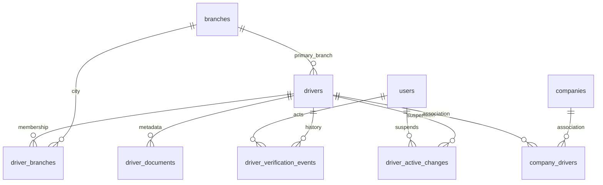

# Revision 8 — Driver verification design (final review)

Proposal only. Nothing here has been applied. `dev-db/001_smt_dev_schema.sql` is unchanged. The database, application, JSON, SQLite, and production configuration are unchanged. Wait for explicit approval before implementation.

`drivers.active` is the operational switch. `drivers.verification_status` is the owner’s verification decision.

## State transitions

| From | Event | To | active afterward | History |
|---|---|---|---|---|
| new row | submission `submitted` | unverified | false | Insert trigger. The caller cannot store `active = true`. |
| unverified | review `verified` | verified | true | New review row. |
| unverified | review `rejected` | rejected | false | New review row. |
| verified | review `rejected` | rejected | false | The earlier verification row stays. |
| rejected | submission `resubmitted` | unverified | false | The rejection row stays. This does not approve the driver. |
| unverified, after resubmit | review `verified` | verified | true | New approval row. The rejection and resubmission rows stay. |
| verified | `set_driver_active` | verified | false, later true | `driver_active_changes` only. Status is not changed. |

`rejected → verified` is refused by `review_driver` and by the guard. A rejected driver must be resubmitted first. `verified → unverified` is also refused.

Existing Revision 7 drivers become `unverified` and keep their current `active` value. They do not receive a backfilled `submitted` event. A legacy row may be active and unverified. New inserts cannot create that combination. Company links and `assignment_guard` are unchanged, so that legacy driver can still be linked and assigned.

## Schema

`dev-db/003_revision8_driver_verification.sql`

- `drivers.verification_status`, default `unverified`.
- `drivers_rejected_stay_inactive`.
- `driver_verification_events`, append-only. Submission names are `submitted` and `resubmitted`. Review names are `verified` and `rejected`.
- `driver_active_changes`, append-only. Stores `driver_id`, `actor_user_id` from `app_uid()`, the unchanged `verification_status`, `active_before`, `active_after`, a mandatory reason, and `created_at`. A check requires the two active values to differ.
- `driver_documents`: type, number, expiry, and `created_at`. No file column.
- `driver_duplicate_warnings` for equal phones or licence numbers. No unique index and no merge.

`license_number` and `license_expiry` stay on `drivers`.

The diagram is also in [Revision 8 driver verification](C:\Users\user\.cursor\projects\c-Users-user-Downloads-smt-invoice-generator-main\canvases\revision8-driver-verification.canvas.tsx).

## Functions and security

`review_driver(driver_id, decision, reason)` approves only when the locked status is `unverified`. Rejection is allowed from `unverified` or `verified`, requires a reason, and sets `active` false. Both write a review event and then update the driver in the same transaction.

`resubmit_driver(driver_id, reason)` is the only path from `rejected` back to `unverified`. It keeps `active` false and appends a submission event. It does not delete the rejection.

`set_driver_active(driver_id, active, reason)` is the only path that changes `active` without changing `verification_status`. It requires an owner, a non-blank reason, and status `verified`. If the requested value equals the stored value, it returns without an update and without an audit row. Otherwise it inserts `driver_active_changes` and then updates `active` only.

The guard allows an active-only change only when `current_user` is `smt_definer`, `app_is_owner()` is true, the status is `verified`, and the transaction-local setting names one unused audit row whose before and after values match this update. The guard then records that row id as used. A later update in the same transaction cannot reuse it, even if its before and after values match again. `smt_owner` and `smt_staff` do not have `UPDATE` on `active` or `verification_status`. A direct `UPDATE` of `active` therefore fails the column privilege, and a definer update without a new audit row fails the guard.

Approval and rejection change `verification_status` and `active` together. That update does not match the active-only guard, so it does not write `driver_active_changes`. Each of those updates likewise consumes one new verification event and cannot reuse an earlier event.

All three functions are `SECURITY DEFINER`, owned by `smt_definer`, with `search_path = pg_catalog` and schema-qualified `public` names. They do not set `row_security`. That setting does not bypass row security: when a policy would apply, `off` makes the query fail instead of returning rows. The actor is `app_uid()` after `app_is_owner()`. There is no reviewer argument. `EXECUTE` is granted only to `smt_owner`. The application reaches them only after `SET ROLE smt_owner` and `set_config('app.user_id', ..., true)` in `authorized_transaction`.

Revision 7 creates `smt_definer` with `BYPASSRLS`. PostgreSQL does not apply row policies, including forced row security, to a role with that attribute. The new policies are still the explicit allow rule: `smt_definer` may `SELECT` and `INSERT` a history row only when `actor_user_id` is `app_uid()` and `app_is_owner()` is true. There is no `UPDATE` or `DELETE` policy. `smt_owner`, `smt_staff`, `smt_driver`, `smt_client`, and `smt_migrate` are not on those policies and receive no insert or modification grant. The guard runs inside the definer function, so its lookup of the new event or audit row is the same role. The row is visible to that lookup because the actor is the current owner. While `BYPASSRLS` remains, the database does not consult the policy; the function still writes only that actor, and the one-row token still rejects a second use.

`driver_record_submission` checks `app_is_owner()` before the `submitted` event. A staff insert raises `Only an owner can create a driver` and the insert rolls back. The directory API is already owner-only. The automatic reason remains `Driver record created.`

Document writes require an owner and a visible driver branch. Staff reads use `staff_can_branch`. Owner and staff history reads stay branch-scoped. History tables have no update or delete policy, and `reject_history_change()` rejects both operations. `smt_driver`, `smt_client`, and `smt_migrate` receive no new grants.

## Rollback

`dev-db/003_revision8_driver_verification_rollback.sql` counts verification events, documents, and active-change rows first. If any count is greater than zero, it raises and the transaction drops nothing. After a real submission, review, document, or suspension exists, corrections are new rows: reject, resubmit, approve from `unverified`, or `set_driver_active`. The history tables are not dropped. The privilege restore grants `UPDATE` on the original `drivers` columns, including `active`, and does not grant table-level `UPDATE`.

The empty window closes when the first new driver, document, or suspension is stored. Existing drivers do not receive a backfilled submission.

## API and UI plan

No application file is changed by this proposal. The same approved local apply needs these changes:

- Include `verification_status` in `_select_drivers`, `_driver_shape`, and the `GET` and `POST /api/drivers` JSON.
- `POST /api/drivers` already selects the row after insert. Once the trigger exists, `data.active` is false even if the request said true. The screen reloads the list and must keep showing that saved Inactive state.
- `POST /api/drivers/<id>/reviews` with `decision` of `verified` or `rejected` and a reason. Owner only. Approve only when the status is `unverified`.
- `POST /api/drivers/<id>/resubmissions` with a reason. Owner only. Only when the status is `rejected`.
- `POST /api/drivers/<id>/active` with `active` and a reason, calling `set_driver_active`. Owner only. Only when the status is `verified`.
- `GET` the verification events and the active-change rows for the driver details screen.
- PostgreSQL driver screen: show the status, both histories, Approve, Reject, Resubmit, Suspend, and Restore. Approve only for unverified. Resubmit only for rejected. Suspend and Restore only for verified, and both ask for a reason.
- If a client still sends `PATCH {"active": true}` for an unverified or rejected driver, return HTTP 400 with a clear sentence. Do not let `authorized_transaction` turn the database error into 503. The practical route is to stop sending that patch and call the review or active endpoint instead.
- Do not change company-link routes, `assignment_guard`, RAC JSON, or SQLite.

## Test plan

Run only after approval, on local `smt_dev`, inside a transaction that rolls back or on a restored local dump.

1. Existing drivers keep their `active` values and become `unverified`. Event, document, and active-change counts are zero. An active legacy driver can still be linked. `assignment_guard` is unchanged.
2. An insert that supplies `active = true` is stored unverified and inactive. `POST /api/drivers` returns `active: false`. One `submitted` event uses the reason `Driver record created.`
3. `review_driver(..., 'verified')` on a rejected driver is denied. The status and the rejection row stay.
4. `resubmit_driver` then `review_driver(..., 'verified')` succeeds. The rejection, resubmission, and approval rows all remain. `active` is true only after the approval.
5. A staff insert into `drivers` fails and leaves no driver row and no submission event.
6. An owner suspends a verified driver with a reason, then restores that driver with a reason. The status stays `verified`. Two `driver_active_changes` rows record the actor and the before and after values.
7. `set_driver_active` with the current active value writes no audit row and does not update the driver.
8. Approval and rejection write verification events and write no `driver_active_changes` row.
9. Staff, driver, client, and a session without `app.user_id` cannot execute the three functions. A direct update of `verification_status` or `active` by owner or staff fails. A blank reason fails. Staff can read a document in a visible branch and cannot insert one.
10. `smt_owner`, `smt_staff`, `smt_driver`, `smt_client`, and `smt_migrate` cannot `INSERT`, `UPDATE`, or `DELETE` `driver_verification_events` or `driver_active_changes`. Owner and staff `SELECT` still follows the driver branch.
11. After one suspension, set the transaction-local change id back to that same audit row and attempt another `active` update. The guard rejects it and the driver keeps the value from the first change. A second suspension requires a new `set_driver_active` call and a new audit row.
12. Rollback with any event, document, or active-change row raises and deletes nothing. Rollback with all three tables empty removes the new objects and leaves the original driver rows.

## Remaining blockers

None in this proposal. Implementation still waits for explicit approval, and the application changes above ship with the local `smt_dev` apply. Production is out of scope.
